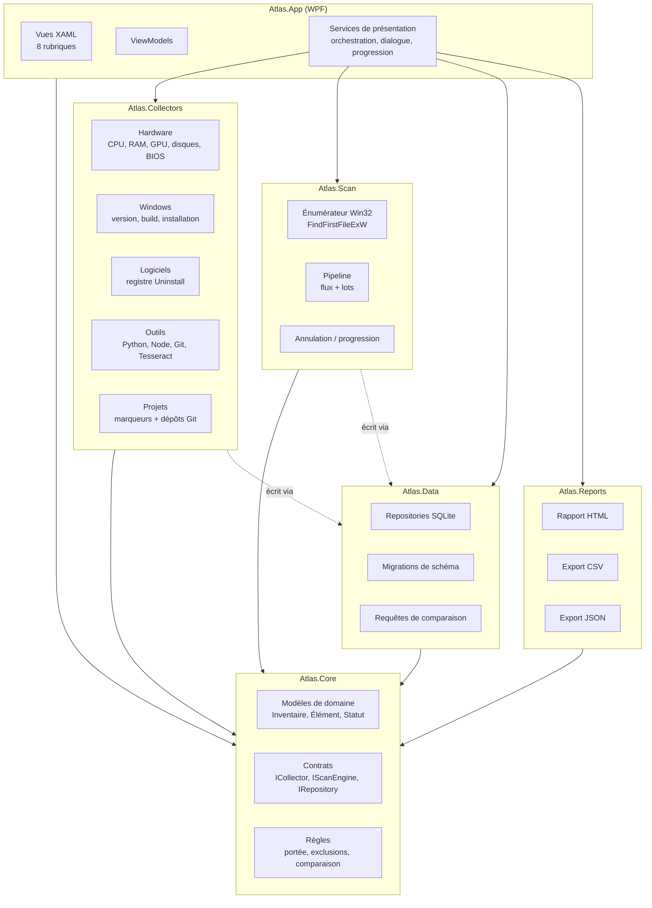

# Livrable 4 — Architecture technique recommandée et justification

---

## 1. Partir des contraintes, pas des technologies

| Contrainte du PC cible | Conséquence architecturale | Ce que cela exclut |
|---|---|---|
| **6 Go de RAM**, dont ~2 Go consommés par Windows | Budget mémoire de l'application : **< 250 Mo en pic**, < 150 Mo au repos | Arbre complet en mémoire, Electron, cache d'images, listes non virtualisées |
| **Disque dur mécanique** | Démarrage à froid court ; peu de lectures aléatoires ; écritures groupées | EXE auto-contenu de 65 Mo, extraction en fichiers temporaires, journalisation par ligne |
| **CPU ancien (bi-cœur)** | **1 travailleur** de scan, UI sur le thread principal uniquement | Pool de threads dimensionné sur les cœurs, animations, rendu continu |
| **1440 × 900** | Interface pensée en 1440 de large, sidebar 220-240 px, aucun scroll horizontal | Mises en page à 4 colonnes, fenêtres à taille fixe |
| **Sans administrateur** | Certaines zones resteront invisibles : il faut les **compter et les signaler** | Scan MFT, accès aux profils d'autres utilisateurs, SMART |
| **Sans Internet, sans API payante** | Tout doit être embarqué ; aucune police web, aucun CDN dans le HTML exporté | Graphiques en ligne, cartes, mises à jour automatiques obligatoires |
| **Lecture seule** | Aucun handle en écriture sur les données utilisateur ; lecture registre uniquement | Nettoyage, corbeille, déplacement, réparation |

Le raisonnement de ce dossier est donc : **choisir la pile la plus légère qui permette
une interface moderne crédible**, puis compenser sa simplicité par la qualité du
moteur et du modèle de données.

---

## 2. Décision 1 — Runtime

### 2.1 Les trois options réelles

| Critère | **.NET Framework 4.8** | **.NET 10 LTS auto-contenu** | **.NET 10 LTS dépendant du runtime** |
|---|---|---|---|
| Présence sur Windows 10 22H2 | **Oui, dans le système** (4.8 inclus ; 4.8.1 installable) | Embarqué dans le dossier de l'app | **Non** : installation du Desktop Runtime requise |
| Poids sur disque | ≈ 10-25 Mo pour l'application seule | ≈ 150-250 Mo décompressé (≈ 60-70 Mo en EXE compressé, comme NeoTreescan) | ≈ 20-40 Mo + 150 Mo de runtime système |
| Démarrage à froid sur disque mécanique | **Rapide** : les assemblies du framework sont déjà sur le disque et mises en cache par le système | **Lent** : centaines de fichiers lus au premier lancement ; extraction en cas de publication single-file | Moyen (runtime partagé, souvent déjà en cache) |
| Support à la date du dossier | Aucune date de fin propre ; suit le cycle de Windows | **LTS jusqu'au 14/11/2028** | idem |
| Situation sur Windows 10 22H2 | Windows 10 22H2 est sorti du support standard le 14/10/2025 (ESU jusqu'en 2028) | Windows 10 22H2 n'est plus dans la table des OS « supportés » de .NET 10, mais l'exécution fonctionne (minimum requis : Windows 10 1607) | idem |
| Modernité du langage | C# 7.3 par défaut ; au-delà, polyfills nécessaires (`IsExternalInit`, `Index`/`Range`) | C# 13-14, bibliothèque complète | idem |
| Risque principal | Framework « legacy » : pas de nouveautés, mais rien ne casse | Poids et lenteur au démarrage ; dépendance à une version qui devra être suivie | Nécessite une installation préalable → contraire à « fonctionne localement, sans friction » |

### 2.2 Recommandation

> **Cible : `.NET Framework 4.8` (`net48`), projets au format SDK, C# 8-9 avec les
> quelques polyfills nécessaires.**
>
> **Chemin de migration écrit dès le premier jour** : la solution doit être
> multi-ciblable (`net48;net10.0-windows`) dans les projets `Core`, `Data`,
> `Collectors` et `Reports`, afin qu'un basculement vers .NET 10 ne soit qu'une
> modification de propriété `TargetFramework` si le PC est remplacé.

**Justification, dans l'ordre d'importance :**

1. **Le temps de démarrage est le premier critère sur un disque mécanique.** Un EXE
   auto-contenu .NET 10 fait lire plusieurs centaines d'assemblies à chaque premier
   lancement ; c'est le défaut que l'auteur de NeoTreescan assume (EXE de 65 Mo,
   extraction incluse). Sur un OptiPlex 780, cela se traduit par plusieurs secondes
   avant le premier pixel. .NET Framework est pré-compilé et déjà présent.
2. **Aucune installation, aucune mise à jour à gérer.** Le cahier des charges impose
   un logiciel qui fonctionne localement et gratuitement ; dépendre du Desktop
   Runtime .NET 10 installerait une dépendance externe sur une machine hors ligne.
3. **Rien dans le cahier des charges n'exige .NET moderne.** Pas de serveur web, pas
   d'API, pas de JSON avancé, pas de `async` massif. WPF sous .NET Framework 4.8 sait
   faire tout ce qui est demandé.
4. **Le support de .NET Framework 4.8 est lié à Windows, pas à une date propre**, et
   Windows 10 22H2 bénéficie d'ESU jusqu'en octobre 2028 — soit exactement la même
   fenêtre que .NET 10 LTS. L'argument « .NET Framework est mort » ne tient pas dans
   ce contexte précis.

**Ce que cette décision coûte, honnêtement :**

- pas de `Span<T>`/`Memory<T>` (donc pas de parsing binaire très rapide) : sans
  importance, ATLAS PC ne fait pas de parsing binaire en V1 ;
- pas de `System.Text.Json` intégré : on utilisera un petit writer maison ou
  `DataContractJsonSerializer` (présent dans le framework) ;
- pas de `Microsoft.Data.Sqlite` « dernière version » garantie : voir § 4 et le point
  à vérifier n° 3 du livrable 9 ;
- l'outillage moderne (analyzers, `nullable`) fonctionne mais avec des compromis ;
- l'écosystème des bibliothèques se détourne progressivement de `net48`.

**Repli documenté** : si, au jalon M0, le démarrage à froid ou l'empreinte mémoire de
`.NET Framework 4.8` s'avérait décevant, ou si l'équipe préfère un runtime supporté
explicitement, basculer sur **.NET 10 LTS auto-contenu** ne change **que** le
`.csproj` et le mode de publication, à condition d'avoir respecté la contrainte
multi-cible dès le départ. C'est la raison pour laquelle cette contrainte figure dans
la recommandation.

### 2.3 Ce qu'il ne faut surtout pas faire

**Copier le choix de NeoTreescan (`net9.0-windows`).** .NET 8 et .NET 9 sont tous
deux hors support depuis le **10 novembre 2026**. Démarrer un projet neuf sur un
runtime déjà non maintenu, sur un OS déjà hors support, cumulerait deux dettes dès le
premier commit.

---

## 3. Décision 2 — Interface graphique

### 3.1 Comparaison

| Option | Poids / RAM | Rendu moderne | Coût de développement | Compatibilité réelle | Verdict |
|---|---|---|---|---|---|
| **WPF** (net48) | Moyen (≈ 80-120 Mo au repos, estimation) | **Élevé** (styles, templates, data binding, virtualisation) | Moyen | Excellente, présente dans le système | **Retenu** |
| WinForms (net48) | **Faible** | Faible sans dessin custom | Faible au début, élevé pour un rendu soigné | Excellente | Repli acceptable |
| WinUI 3 / Windows App SDK | Élevé | Très élevé | Élevé | Dépend du Windows App SDK, sensible au GPU, cible Win10 1809+ | Écarté |
| Avalonia | Moyen-élevé (Skia) | Élevé | Moyen | Hors du chemin `net48` usuel, dépendance native supplémentaire | Écarté |
| Electron (choix de Diskplot) | **Très élevé** | Élevé | Moyen | Excellente | Écarté (6 Go / disque mécanique) |
| C++/Win32 (choix de WinDirStat) | Faible | Élevé mais coûteux | **Très élevé** | Parfaite | Écarté |

### 3.2 Justification du choix WPF

- **Data binding + virtualisation** : afficher 400 000 lignes n'a de sens que si l'on
  n'en matérialise que ~50 à l'écran. `DataGrid` et `ListView` le font nativement
  (`EnableRowVirtualization`), ce qui est décisif pour la rubrique « Fichiers ».
- **Feuilles de style et templates** : obtenir une interface à sidebar, cartes et
  badges cohérents demande du XAML, pas un framework complet.
- **Rendu de graphiques simple** : une barre ou un anneau se dessine avec des
  primitives ; pas besoin de bibliothèque.
- **DPI** : WPF est indépendant de la résolution par conception ; à 1440 × 900 en
  96 DPI, aucun réglage particulier. Il faut néanmoins déclarer `PerMonitorV2` dans
  le manifeste (comme NeoTreescan) pour rester net si l'écran change.
- **Compétence transférable** : le code C#/XAML d'un projet WPF est directement
  lisible par rapport aux trois dépôts C#/PS étudiés.

### 3.3 Pourquoi pas WinForms, malgré sa légèreté

WinForms est l'« alternative légère » évidente : empreinte plus faible, démarrage plus
rapide, aucune couche de composition graphique. Il a été écarté pour trois raisons
précises, et non par préférence :

1. **La virtualisation des listes n'est pas native.** Un `DataGridView` en mode
   virtualisé demande d'écrire `CellValueNeeded` et de gérer le tri et le filtrage à la
   main ; en WPF, `DataGrid` le fait déjà. Sur 400 000 lignes, c'est la différence
   entre une journée de travail et une demi-journée, mais surtout entre un code
   robuste et un code fragile.
2. **Le rendu soigné se paie.** Cartes, badges, barres de proportion, anneau : en
   WinForms, tout se dessine dans `OnPaint` (c'est exactement ce que fait System
   Inspector, avec des positions absolues et un `Graphics.FillRectangle` par élément).
   Le résultat est correct mais coûteux à maintenir et peu adaptatif au
   redimensionnement.
3. **La mise en page adaptative.** À 1440 × 900 avec une barre latérale de 232 px et
   des cartes fluides, `TableLayoutPanel` et `Dock` deviennent vite rigides ; XAML
   exprime la même chose en quelques lignes de `Grid`.

**Verdict** : WinForms reste le **repli** si la mesure de M0 montre que WPF coûte trop
cher en mémoire ou en démarrage sur cette machine. C'est un repli chiffrable, pas une
hypothèse : la coquille est justement l'objet du jalon M0.

### 3.4 Ce que WPF impose de discipline

- **Pas d'animations** : sur un bi-cœur et un GPU intégré, chaque animation coûte.
  Transitions autorisées : aucune en V1, sauf un fondu de 120 ms au changement de vue
  (optionnel, mesuré).
- **Pas de `ScrollViewer` contenant une `ItemsControl` non virtualisée** : erreur
  classique qui matérialise tout.
- **Pas de convertisseurs coûteux** dans les cellules ; formater en amont.
- **Chargement paresseux** de l'arborescence, comme le fait NeoTreescan
  (`FolderNodeViewModel.OnIsExpandedChanged`).
- **Thread unique pour l'UI** : les collectes et le scan notifient par
  `IProgress<T>` (qui reposte sur le `SynchronizationContext`), jamais par accès
  direct aux collections.

---

## 4. Décision 3 — Base de données

**SQLite**, en fichier unique, sans service.

| Option | Verdict |
|---|---|
| **SQLite** via `Microsoft.Data.Sqlite` (+ `SQLitePCLRaw`) ou `System.Data.SQLite` | **Retenu** : fichier unique, SQL pour la comparaison, aucune installation, licence permissive |
| Fichiers JSON/CSV par inventaire | Écarté : la comparaison fichier par fichier exigerait de tout charger en mémoire |
| LiteDB (NoSQL embarqué) | Écarté : moins adapté aux jointures de comparaison, moins pérenne |
| SQL Server Express / LocalDB | Écarté : service, installation, RAM |

Justification du besoin relationnel : la fonctionnalité 7 (comparer deux inventaires :
fichiers ajoutés, disparus, modifiés, évolution du stockage) est **une jointure**.
Un modèle relationnel la rend déclarative et testable ; un format de fichiers la rend
algorithmique et fragile.

Détail du schéma et des requêtes : `docs/08-modele-sqlite.md`.

---

## 5. Vue d'ensemble de l'architecture



**Règle de dépendance, non négociable :**

```
Atlas.App  ──►  Atlas.Core  ◄──  Atlas.Collectors
    │              ▲        ◄──  Atlas.Scan
    ├──────────►   │        ◄──  Atlas.Data
    └──────────►   │        ◄──  Atlas.Reports
```

- `Atlas.Core` ne référence **rien** (ni WPF, ni SQLite, ni `System.Management`).
- Aucun projet ne référence `Atlas.App`.
- `Atlas.Data` ne connaît pas WPF ; `Atlas.App` ne contient pas de SQL.
- Les collecteurs et le scan **n'écrivent pas** directement en base : ils produisent
  des objets, un service de persistance les enregistre. Cela permet de tester un
  collecteur sans base et une base sans Windows.

---

## 6. Le moteur d'inventaire : pipeline

### 6.1 Séquence d'un inventaire

```
1. Préparation      → lecture de la configuration, ouverture de la base, création
                      de la ligne `inventory` à l'état `running`
2. Matériel & OS    → collecteurs rapides (< 10 s attendu), résultats en mémoire
3. Logiciels        → lecture du registre, résultats en mémoire
4. Outils           → résolution des chemins, lecture de versions
5. Fichiers         → parcours en flux : chaque lot de N fichiers est écrit en base
6. Projets          → dérivés du parcours de fichiers (aucun surcoût de lecture)
7. Consolidation    → totaux par dossier, totaux généraux, comptage des erreurs
8. Clôture          → état `complete` / `partial` / `cancelled`, horodatage, exports
```

Justification de l'ordre : les étapes 2 à 4 sont **courtes** et donnent à
l'utilisateur un résultat visible en quelques secondes (« le PC est un OptiPlex 780
avec 6 Go »), avant l'étape 5 qui dure plusieurs minutes. C'est un choix d'ergonomie
autant que de performance.

### 6.2 Le parcours de fichiers en flux

Principe : **on ne construit jamais l'arbre des fichiers en mémoire.**

- Pile de dossiers à visiter (`Stack<DossierEnCours>`), **un seul travailleur**.
- Pour chaque dossier :
  1. `FindFirstFileExW` avec `FindExInfoBasic` + `FIND_FIRST_EX_LARGE_FETCH`,
     chemin préfixé par `\\?\` ;
  2. pour chaque entrée : accumuler dans un **tampon de lot** (2 000 entrées ou 2 s) ;
  3. à chaque point de contrôle (toutes les N entrées) : vérifier le jeton
     d'annulation, publier la progression ;
  4. à la fin du dossier : calculer le total du dossier, l'empiler pour mise à jour
     du parent (ou l'écrire directement en base en ordre post-ordre).
- Les totaux par dossier sont tenus dans une **petite structure en mémoire**
  (`Dictionary<long, TotauxDossier>` ou pile), car il y a ~10 à 60 fois moins de
  dossiers que de fichiers : 60 000 dossiers × ~100 octets ≈ 6 Mo.
- Les fichiers, eux, partent en base par lots, dans **une transaction par lot**.

**Budget mémoire résultant** (estimations à valider en M2) :

| Poste | Estimation |
|---|---|
| Processus WPF au repos | 80-120 Mo |
| Totaux des dossiers en mémoire | 5-8 Mo |
| Tampon de lot (2 000 × ~250 o) | < 1 Mo |
| Cache SQLite (`cache_size`) | 8 Mo |
| Lignes visibles dans les grilles | < 10 Mo |
| **Pic visé** | **< 250 Mo** |

À comparer aux 250-400 Mo **de données seules** du modèle NeoTreescan pour 400 000
fichiers (rapport 01, § 4), auxquels s'ajoute le reste de l'application.

### 6.3 Modèle de concurrence

| Élément | Choix | Justification |
|---|---|---|
| Travailleurs de scan | **1** par défaut (`MaxWorkers = 1`), réglable 1-2 | Disque mécanique : le parallélisme provoque des déplacements de tête. Deux travailleurs n'ont de sens que pour deux volumes distincts. |
| Thread UI | jamais bloqué | Toute E/S passe par `Task.Run` + `IProgress<T>` |
| Écritures en base | sur le thread du travailleur, par lots | Évite un thread supplémentaire et une file supplémentaire |
| Collecteurs WMI | séquentiels, un par un | Chaque requête CIM a un coût fixe ; les paralléliser sature le service WMI |
| Progression | publication à **500 ms** maximum | 200 ms (NeoTreescan) génère 3 messages/s pour rien ; 500 ms suffit à une barre fluide |

### 6.4 Annulation et états

Trois issues distinctes, comme dans WinDirStat et Diskplot :

| Issue | Déclencheur | Effet |
|---|---|---|
| `complete` | fin naturelle | inventaire complet, comparable |
| `partial` | annulation utilisateur après au moins un lot écrit, ou erreurs bloquantes sur une branche | inventaire conservé, **marqué incomplet**, zones en erreur listées |
| `cancelled` | annulation avant tout lot, ou abandon | ligne supprimée ou marquée, jamais proposée à la comparaison |

Règle d'affichage : un inventaire `partial` porte un badge visible dans **toutes** les
vues et dans **tous** les exports. C'est l'application directe de la règle « ne pas
prétendre qu'un inventaire est complet ».

### 6.5 Gestion des erreurs et zones non analysées

Chaque erreur produit une ligne `inventory_error` :
`(inventory_id, category, path, win32_code, message, count_if_aggregated)`.

- Les erreurs **identiques sur un même dossier** sont agrégées (pas 10 000 lignes
  « accès refusé »).
- L'interface affiche en permanence un compteur « N dossiers inaccessibles », cliquable.
- Le rapport HTML contient une section « Zones non analysées » obligatoire, même vide.

### 6.6 Adaptations spécifiques au disque mécanique

| Mesure | Effet attendu |
|---|---|
| Lecture séquentielle, profondeur d'abord | regroupe les accès par voisinage sur le disque |
| Tampon d'énumération large (`FIND_FIRST_EX_LARGE_FETCH`) | moins d'appels système par dossier |
| Écritures groupées toutes les 2 s / 2 000 entrées | évite les micro-écritures sur le disque système |
| `PRAGMA synchronous = NORMAL`, `journal_mode = WAL` | moins de synchronisations physiques, base toujours cohérente |
| Option « mode discret » : pause de 2 ms entre deux dossiers | rend la machine utilisable pendant le scan, au prix de la durée |
| Aucune lecture de contenu de fichier | aucun déplacement supplémentaire de tête |

**Estimation de durée** (à mesurer au jalon M2, pas une promesse) : sur un disque
mécanique de cette génération, une énumération coûte typiquement 5-15 ms par dossier
lorsque les métadonnées ne sont pas en cache. Pour ~60 000 dossiers et ~400 000
fichiers : **de l'ordre de 5 à 15 minutes** pour un volume entier, avec de fortes
variations selon la fragmentation et l'antivirus. La deuxième exécution est plus
rapide (cache système).

---

## 7. Modules de collecte

### 7.1 Matériel et Windows (rubrique « Ordinateur »)

| Donnée | Source prévue | Remarque |
|---|---|---|
| Fabricant, modèle, type de châssis | `Win32_ComputerSystem`, `Win32_SystemEnclosure` | valeurs souvent « Dell Inc. » / « OptiPlex 780 » |
| CPU (modèle, cœurs, fréquence) | `Win32_Processor` | le CPU est un Core 2 Duo : pas de fréquence turbo à chercher |
| RAM (barrettes, slots, vitesse) | `Win32_PhysicalMemory`, `Win32_PhysicalMemoryArray` | la topologie des canaux n'est pas fiable : ne pas l'inventer |
| GPU | `Win32_VideoController` | VRAM souvent mal reportée : marquer `approx` |
| Disques physiques | `Win32_DiskDrive` | modèle, taille, interface |
| Partitions | `Win32_DiskPartition` + `Win32_LogicalDiskToPartition` | association disque ↔ volume |
| Volumes | `Win32_LogicalDisk`, `GetDiskFreeSpaceEx` | taille, libre, système de fichiers, taille de cluster |
| Windows | registre `CurrentVersion` + `Win32_OperatingSystem` | nom, édition, build, UBR, date d'installation |
| BIOS | `Win32_BIOS` | fabricant, version, date |

**Sans administrateur**, ces classes sont lisibles pour un utilisateur standard. Deux
réserves documentées : certaines valeurs (numéros de série, SMART) peuvent être
refusées ou absentes, et la VRAM rapportée par WMI n'est pas fiable pour les GPU
intégrés — dans les deux cas, le champ porte un statut `NotAvailable` ou `Approx`,
jamais une valeur inventée.

### 7.2 Logiciels installés

Source : clés `Uninstall` du registre, en lecture seule :

- `HKLM\SOFTWARE\Microsoft\Windows\CurrentVersion\Uninstall\*`
- `HKLM\SOFTWARE\WOW6432Node\Microsoft\Windows\CurrentVersion\Uninstall\*`
- `HKCU\SOFTWARE\Microsoft\Windows\CurrentVersion\Uninstall\*`

Champs retenus : `DisplayName`, `DisplayVersion`, `Publisher`, `InstallLocation`,
`InstallDate`, `EstimatedSize`, `SystemComponent`, `ParentKeyName`, `WindowsInstaller`.

Règles de filtrage explicites (à documenter dans l'interface) :
- ignorer les entrées sans `DisplayName` ;
- ignorer `SystemComponent = 1` (composants, correctifs) ;
- ignorer les entrées avec `ParentKeyName` (mises à jour de composants) ;
- conserver les entrées `WindowsInstaller` mais les marquer, car leurs dates et
  tailles sont peu fiables.

**Applications portables** : c'est la partie la plus incertaine. Définition proposée,
volontairement conservatrice :
1. exécutables cités par les raccourcis `.lnk` du menu Démarrer et du bureau
   (lecture de la cible du raccourci) ;
2. exécutables situés hors des dossiers d'installation connus, dans un nombre limité
   de dossiers choisis par l'utilisateur ;
3. tout élément détecté porte `source = "portable"` et `confidence = "low"`.

Aucune traversée complète du disque pour chercher des `.exe` : ce serait un second
scan complet, coûteux et de faible valeur. Si l'utilisateur a lancé un inventaire
fichiers, les exécutables déjà connus peuvent être réutilisés **sans nouvelle
lecture**. Ce point est signalé comme risque (livrable 9, risque R6).

### 7.3 Outils de développement

| Outil | Détection | Version |
|---|---|---|
| Python | `py.exe` (lanceur), `python.exe` dans le PATH, `%LOCALAPPDATA%\Programs\Python\Python*`, `C:\Python*` | `FileVersionInfo` du `python.exe`, sinon `python --version` |
| pip | `pip.exe` à côté de Python, `python -m pip --version` | version retournée par la commande |
| Node.js | `node.exe` dans le PATH, `%ProgramFiles%\nodejs` | `FileVersionInfo` (fiable), sinon `node --version` |
| npm | `npm.cmd` à côté de Node | lecture de `package.json` de npm, sinon `npm --version` |
| Git | `git.exe` dans le PATH, `%ProgramFiles%\Git\cmd` | `git --version` (pas d'information de version dans le PE) |
| Tesseract | `tesseract.exe` dans le PATH, `%ProgramFiles%\Tesseract-OCR` | `tesseract --version` (écrit sur la sortie d'erreur) |

**Ordre de préférence des méthodes**, du moins coûteux au plus coûteux :
1. `FileVersionInfo.GetVersionInfo` — aucune exécution, lecture de métadonnées ;
2. lecture d'un fichier de version (`package.json` de npm, `_version` de pip) ;
3. exécution de `--version` **avec un délai de 3 s, sans shell, sans redirection
   d'entrée**.

L'exécution de `--version` est en lecture seule mais coûte un démarrage de processus
(≈ 50-300 ms chacun). Elle doit être désactivable et son échec ne doit jamais
interrompre l'inventaire.

**Limite explicite** : un outil installé mais absent du PATH et hors des emplacements
connus ne sera pas trouvé. C'est une limite à afficher, pas à masquer.

### 7.4 Projets

Aucune lecture supplémentaire : les marqueurs sont détectés **pendant** le parcours
de fichiers, en comparant le nom des entrées à une table de correspondance :

| Marqueur | Type de projet |
|---|---|
| `package.json` | Node.js / JavaScript |
| `requirements.txt`, `pyproject.toml`, `setup.py`, `Pipfile` | Python |
| `*.csproj`, `*.sln` | .NET |
| `Cargo.toml` | Rust |
| `go.mod` | Go |
| `.git` (dossier) | dépôt Git |

Deux garde-fous indispensables :
- **ne pas remonter un projet à l'intérieur de `node_modules`, `venv`, `.venv`,
  `site-packages`, `dist`, `build`, `target`** : sans cela, un seul projet Node peut
  produire des centaines de faux positifs ;
- **ne pas dédupliquer à l'excès** : un même dossier peut cumuler `package.json` et
  `.git` ; on conserve les deux marqueurs sur une seule ligne de projet.

Le statut « dépôt Git » est constaté par la présence du dossier `.git` ; la lecture de
`HEAD`, de la branche ou du remote est une **extension possible** (elle lit un petit
fichier texte, sans risque), mais n'est pas nécessaire en V1 : à ne pas ajouter sans
justification.

---

## 8. Persistance et historique

Voir le livrable 5 (`docs/08-modele-sqlite.md`) pour le schéma complet. Principes
architecturaux :

1. **Un inventaire = une ligne `inventory` + un ensemble de lignes filles**, toutes
   rattachées par `inventory_id`.
2. **Aucune image binaire opaque** : tout est interrogeable en SQL.
3. **Normalisation du chemin** : les dossiers sont une table, les fichiers portent
   `folder_id` + `name`. Le chemin complet est reconstruit par requête récursive, ce
   qui évite de stocker 400 000 fois les mêmes 80 caractères de préfixe.
4. **Politique de rétention explicite** : N inventaires détaillés (3 par défaut) +
   inventaires allégés au-delà (dossiers et totaux seulement). Sans elle, un
   historique de 20 inventaires détaillés consommerait plusieurs centaines de Mo sur
   le disque qu'il surveille — le piège identifié chez Diskplot.
5. **Aucun contenu de fichier** : ni texte, ni hash de contenu, ni aperçu.

---

## 9. Rapports

| Format | Méthode | Justification |
|---|---|---|
| **HTML** | gabarit unique, CSS embarqué, aucune ressource externe | lisible hors ligne, imprimable, archivable ; modèle fourni par System Inspector |
| **CSV** | un fichier par section (`ordinateur.csv`, `logiciels.csv`, `fichiers.csv`…) ou un CSV par vue | ouvert par Excel/LibreOffice sans dépendance |
| **JSON** | schéma stable et versionné (`schemaVersion`) | exploitable par un script, reproductible |
| PDF | **hors V1** | générer du PDF impose une bibliothèque (licence + poids) ou une impression via WebBrowser ; à décider après la V1 |

Le rapport HTML doit contenir, dans cet ordre : en-tête (date, durée, portée, état),
synthèse chiffrée avec les graphiques, sections par rubrique, **zones non analysées**,
puis annexe méthodologique (sources, méthodes de détection, limites).

---

## 10. Comment la lecture seule est garantie — par construction

La règle « ne jamais modifier » ne doit pas dépendre de la bonne volonté du
développeur. Mesures concrètes :

| Mesure | Mise en œuvre |
|---|---|
| Énumération sans ouverture de fichier | `FindFirstFileExW` lit les métadonnées sans ouvrir le contenu |
| Ouverture de dossier en lecture | `FILE_LIST_DIRECTORY` + `FILE_SHARE_READ\|WRITE\|DELETE` uniquement |
| Registre | `OpenSubKey(..., writable: false)` ; aucun `SetValue`, `DeleteSubKey`, `CreateSubKey` |
| WMI | uniquement des requêtes de propriétés ; **aucune** invocation de méthode ; `Win32_Product` **interdit** (déclenche des réparations MSI) |
| Aucune suppression/déplacement | pas de `File.Delete`, `File.Move`, `Directory.Delete`, corbeille, ni `SHFileOperation` |
| Processus externes | uniquement `--version`, sans shell, avec délai |
| Écritures | limitées à `%LOCALAPPDATA%\ATLAS PC\` (base, journaux, exports choisis par l'utilisateur) |
| Preuve automatisée | un **test unitaire « garde-fou »** échoue si `Atlas.Scan` ou `Atlas.Collectors` contient un appel à une API d'écriture (analyse par réflexion sur les types + recherche textuelle dans les assemblies) |
| Revue | liste de contrôle de revue de code avec la mention « aucune API d'écriture ajoutée » |

---

## 11. Ce que l'architecture refuse explicitement

| Tenté par l'un des dépôts | Refusé pour ATLAS PC | Motif |
|---|---|---|
| Scan MFT NTFS | ❌ V1 | exige l'administrateur ; code dense spécifique NTFS |
| Parallélisme par cœur | ❌ | disque mécanique bi-cœur |
| Arbre complet en mémoire | ❌ | 6 Go de RAM |
| Lecture de contenu (hachage) | ❌ V1 | hors périmètre, coût d'E/S, esprit « métadonnées seulement » |
| Surveillance temps réel (`fs.watch`) | ❌ | coût permanent, hors cahier des charges |
| Suppression / nettoyage | ❌ | contraire à la règle de lecture seule |
| Instantanés binaires propriétaires | ❌ | non interrogeables |
| Treemap en V1 | ⏸ reporté | coût de développement élevé, non exigé ; les barres suffisent d'abord |
| PDF | ⏸ après V1 | dépendance et temps |

---

## 12. Résumé de la décision

> ATLAS PC sera une **application WPF en C# sur .NET Framework 4.8**, organisée en
> sept projets, adossée à **SQLite**, dont le moteur d'inventaire parcourt les
> fichiers **en un seul flux, sur un seul travailleur**, en écrivant **par lots** en
> base, sans jamais conserver l'arbre des fichiers en mémoire, sans jamais ouvrir un
> fichier en écriture, et en marquant explicitement tout ce qu'il n'a pas pu lire.

Cette phrase est la synthèse de tout ce dossier : elle découle des contraintes du PC
cible (§ 1), des défauts mesurés des quatre dépôts (livrables 1 et 2) et de la
nécessité d'une comparaison fichier par fichier (livrable 5).
