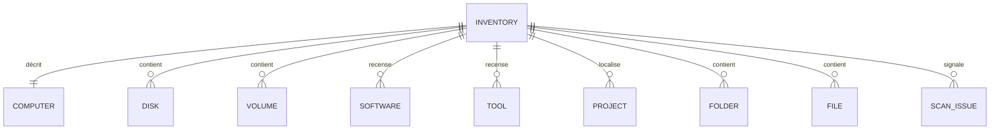

# Livrable 5 — Modèle SQLite réduit

> **Révision du 17 novembre 2026.** 10 tables au lieu de 20 : plus de hachage de
> chemin, plus de statistiques pré-calculées, plus de table de statut par champ, plus
> de portée multi-racines, plus de rétention automatique.

---

## 1. Principes

| Principe | Traduction |
|---|---|
| Un fichier est identifié par son **chemin complet normalisé** | colonnes `folder_path` + `name`, jointure directe entre inventaires |
| Pas d'identifiant technique sophistiqué | aucun hachage, aucune clé dérivée |
| Les totaux se calculent à la demande | `SUM`/`COUNT` sur index, aucune table d'agrégats |
| L'utilisateur décide de ce qu'il garde | aucun mécanisme de purge automatique |
| Seules les données de la V1 | ni taille allouée, ni attributs, ni partitions, ni portables |
| Rien de personnel | aucun contenu, aucun hash de contenu |

Fichier : `%LOCALAPPDATA%\ATLAS PC\atlas.db`.

---

## 2. Les dix tables



| Table | Rôle | Volume attendu |
|---|---|---|
| `inventory` | un inventaire daté | 1 ligne par inventaire |
| `computer` | matériel principal + Windows | 1 ligne |
| `disk` | disques physiques | 1-2 lignes |
| `volume` | volumes (C:, D:…) | 1-4 lignes |
| `software` | logiciels installés | 100-400 lignes |
| `tool` | les 6 outils de développement | 6 lignes |
| `project` | projets Python / Node.js | dizaines |
| `folder` | dossiers et totaux | ~60 000 |
| `file` | fichiers (métadonnées seules) | ~400 000 |
| `scan_issue` | zones non analysées | quelques dizaines à quelques milliers |

---

## 3. DDL

```sql
PRAGMA journal_mode = WAL;
PRAGMA synchronous  = NORMAL;
PRAGMA foreign_keys = ON;
PRAGMA cache_size   = -8000;    -- ~8 Mo
PRAGMA temp_store   = MEMORY;

-- 1. Inventaires ------------------------------------------------------------
CREATE TABLE inventory (
    id            INTEGER PRIMARY KEY,
    started_at    TEXT    NOT NULL,             -- ISO-8601 UTC
    finished_at   TEXT,
    status        TEXT    NOT NULL              -- complete | partial | cancelled
                  CHECK (status IN ('complete','partial','cancelled')),
    root_path     TEXT    NOT NULL,             -- ex. 'C:\'
    app_version   TEXT    NOT NULL,
    files_count   INTEGER NOT NULL DEFAULT 0,
    folders_count INTEGER NOT NULL DEFAULT 0,
    total_bytes   INTEGER NOT NULL DEFAULT 0,
    issues_count  INTEGER NOT NULL DEFAULT 0,
    note          TEXT
);

-- 2. Matériel principal et Windows ------------------------------------------
CREATE TABLE computer (
    inventory_id  INTEGER PRIMARY KEY REFERENCES inventory(id) ON DELETE CASCADE,
    manufacturer  TEXT, model TEXT,
    cpu_name      TEXT, cpu_cores INTEGER,
    ram_bytes     INTEGER,
    gpu_name      TEXT,
    bios_vendor   TEXT, bios_version TEXT,
    os_name       TEXT, os_version TEXT, os_build TEXT,
    os_arch       TEXT, os_install_date TEXT
);

-- 3. Disques physiques ------------------------------------------------------
CREATE TABLE disk (
    id           INTEGER PRIMARY KEY,
    inventory_id INTEGER NOT NULL REFERENCES inventory(id) ON DELETE CASCADE,
    disk_index   INTEGER,
    model        TEXT,
    size_bytes   INTEGER
);

-- 4. Volumes ----------------------------------------------------------------
CREATE TABLE volume (
    id           INTEGER PRIMARY KEY,
    inventory_id INTEGER NOT NULL REFERENCES inventory(id) ON DELETE CASCADE,
    drive        TEXT,                          -- 'C:'
    label        TEXT,
    file_system  TEXT,
    total_bytes  INTEGER,
    free_bytes   INTEGER,
    disk_index   INTEGER
);

-- 5. Logiciels installés ----------------------------------------------------
CREATE TABLE software (
    id               INTEGER PRIMARY KEY,
    inventory_id     INTEGER NOT NULL REFERENCES inventory(id) ON DELETE CASCADE,
    name             TEXT NOT NULL,
    version          TEXT,
    publisher        TEXT,
    install_location TEXT,
    install_date     TEXT
);

-- 6. Outils de développement ------------------------------------------------
CREATE TABLE tool (
    id           INTEGER PRIMARY KEY,
    inventory_id INTEGER NOT NULL REFERENCES inventory(id) ON DELETE CASCADE,
    kind         TEXT NOT NULL,                 -- python|pip|node|npm|git|tesseract
    path         TEXT,
    version      TEXT,
    status       TEXT NOT NULL                  -- found|not_found|failed
);

-- 7. Projets ----------------------------------------------------------------
CREATE TABLE project (
    id           INTEGER PRIMARY KEY,
    inventory_id INTEGER NOT NULL REFERENCES inventory(id) ON DELETE CASCADE,
    path         TEXT NOT NULL,
    kind         TEXT NOT NULL,                 -- python|node
    is_git       INTEGER NOT NULL DEFAULT 0
);

-- 8. Dossiers ---------------------------------------------------------------
CREATE TABLE folder (
    id           INTEGER PRIMARY KEY,
    inventory_id INTEGER NOT NULL REFERENCES inventory(id) ON DELETE CASCADE,
    parent_path  TEXT,                          -- NULL pour la racine analysée
    path         TEXT NOT NULL,                 -- chemin complet du dossier
    size_bytes   INTEGER NOT NULL DEFAULT 0,
    files_count  INTEGER NOT NULL DEFAULT 0,
    dirs_count   INTEGER NOT NULL DEFAULT 0
);

-- 9. Fichiers ---------------------------------------------------------------
CREATE TABLE file (
    id           INTEGER PRIMARY KEY,
    inventory_id INTEGER NOT NULL REFERENCES inventory(id) ON DELETE CASCADE,
    folder_path  TEXT NOT NULL,                 -- dossier contenant
    name         TEXT NOT NULL,
    ext          TEXT,                          -- minuscule, sans point, '' si aucune
    size_bytes   INTEGER NOT NULL,
    modified_at  TEXT NOT NULL                  -- ISO-8601 UTC
);

-- 10. Zones non analysées ---------------------------------------------------
CREATE TABLE scan_issue (
    id           INTEGER PRIMARY KEY,
    inventory_id INTEGER NOT NULL REFERENCES inventory(id) ON DELETE CASCADE,
    path         TEXT NOT NULL,                 -- dossier qui a échoué
    code         INTEGER,                       -- code d'erreur .NET / Win32
    message      TEXT
);
```

### Index

```sql
CREATE INDEX ix_inventory_date  ON inventory(started_at DESC);

CREATE INDEX ix_software_name   ON software(inventory_id, name);
CREATE INDEX ix_tool_kind       ON tool(inventory_id, kind);
CREATE INDEX ix_project_path    ON project(inventory_id, path);

CREATE INDEX ix_folder_path     ON folder(inventory_id, path COLLATE NOCASE);
CREATE INDEX ix_folder_parent   ON folder(inventory_id, parent_path COLLATE NOCASE);
CREATE INDEX ix_folder_size     ON folder(inventory_id, size_bytes DESC);

-- l'index qui rend la comparaison possible et rapide
CREATE INDEX ix_file_key        ON file(inventory_id, folder_path COLLATE NOCASE,
                                        name COLLATE NOCASE);
CREATE INDEX ix_file_folder     ON file(inventory_id, folder_path COLLATE NOCASE);
CREATE INDEX ix_file_ext        ON file(inventory_id, ext, size_bytes DESC);

CREATE INDEX ix_issue_path      ON scan_issue(inventory_id, path COLLATE NOCASE);
```

`COLLATE NOCASE` : les chemins Windows sont insensibles à la casse. Limite connue,
documentée : `NOCASE` ne traite que l'ASCII, donc une différence de casse sur un nom
accentué ne serait pas détectée. C'est sans conséquence pratique (Windows ne crée pas
deux noms ne différant que par la casse d'une lettre accentuée).

---

## 4. Pourquoi « dossier + nom » plutôt qu'un chemin unique

Le cahier des charges demande de comparer sur le **chemin complet normalisé**. Deux
colonnes `folder_path` + `name` **sont** ce chemin complet, avec deux avantages :

- on n'écrit pas 70 caractères de préfixe 400 000 fois pour rien — la jointure porte
  sur `(folder_path, name)`, couverte par un seul index ;
- la jointure entre deux inventaires n'a besoin d'aucune fonction de chaîne, donc
  aucun calcul par ligne.

Aucune autre clé n'est nécessaire : pas de hachage, pas d'`id` de dossier dans la
table des fichiers, pas de table de correspondance.

---

## 5. Comparaison : quatre résultats

### 5.1 Fichiers ajoutés

```sql
SELECT b.folder_path, b.name, b.ext, b.size_bytes, b.modified_at
FROM file b
WHERE b.inventory_id = :b
  AND NOT EXISTS (
      SELECT 1 FROM file a
      WHERE a.inventory_id = :a
        AND a.folder_path = b.folder_path COLLATE NOCASE
        AND a.name        = b.name        COLLATE NOCASE)
ORDER BY b.size_bytes DESC
LIMIT 500;
```

### 5.2 Fichiers modifiés

```sql
SELECT b.folder_path, b.name, a.size_bytes AS taille_avant, b.size_bytes AS taille_apres,
       a.modified_at AS date_avant, b.modified_at AS date_apres
FROM file b
JOIN file a
  ON a.inventory_id = :a
 AND a.folder_path  = b.folder_path COLLATE NOCASE
 AND a.name         = b.name        COLLATE NOCASE
WHERE b.inventory_id = :b
  AND (a.size_bytes <> b.size_bytes OR a.modified_at <> b.modified_at)
ORDER BY ABS(b.size_bytes - a.size_bytes) DESC
LIMIT 500;
```

### 5.3 Fichiers supprimés — avec la garde imposée

> **Règle du cahier des charges** : ne jamais annoncer la disparition d'un fichier
> lorsque la zone correspondante n'a pas été correctement analysée.

Un fichier n'est déclaré **supprimé** que si l'inventaire récent ne contient **aucune
zone en erreur** couvrant son dossier. Sinon, il est compté séparément comme
**« disparition non vérifiable »** et n'est jamais présenté comme une suppression.

```sql
WITH candidats AS (
    SELECT a.folder_path, a.name, a.ext, a.size_bytes, a.modified_at
    FROM file a
    WHERE a.inventory_id = :a
      AND NOT EXISTS (
          SELECT 1 FROM file b
          WHERE b.inventory_id = :b
            AND b.folder_path = a.folder_path COLLATE NOCASE
            AND b.name        = a.name        COLLATE NOCASE)
)
SELECT c.folder_path, c.name, c.ext, c.size_bytes, c.modified_at,
       CASE WHEN EXISTS (
                SELECT 1 FROM scan_issue s
                WHERE s.inventory_id = :b
                  AND ( c.folder_path = s.path COLLATE NOCASE
                     OR c.folder_path LIKE s.path || '\%' ESCAPE '\' )
            ) THEN 0 ELSE 1 END AS suppression_confirmee
FROM candidats c
ORDER BY c.size_bytes DESC
LIMIT 500;
```

- `suppression_confirmee = 1` → affiché dans « Fichiers supprimés » ;
- `suppression_confirmee = 0` → affiché dans « Disparitions non vérifiables », avec le
  chemin de la zone responsable.

Le nombre de lignes de `scan_issue` étant petit (quelques dizaines à quelques
milliers), le test de préfixe reste rapide.

### 5.4 Évolution de l'espace occupé

```sql
-- Écart global
SELECT b.total_bytes - a.total_bytes AS delta_total,
       a.total_bytes AS avant, b.total_bytes AS apres,
       b.files_count - a.files_count AS delta_fichiers
FROM inventory a, inventory b
WHERE a.id = :a AND b.id = :b;

-- Écart par dossier de premier niveau
SELECT tb.path, ta.size_bytes AS avant, tb.size_bytes AS apres,
       tb.size_bytes - COALESCE(ta.size_bytes, 0) AS delta
FROM folder tb
LEFT JOIN folder ta
       ON ta.inventory_id = :a
      AND ta.path = tb.path COLLATE NOCASE
WHERE tb.inventory_id = :b
  AND tb.parent_path = (SELECT root_path FROM inventory WHERE id = :b)
ORDER BY ABS(delta) DESC;
```

Le second niveau (`parent_path` renseigné) permet d'afficher l'évolution dossier par
dossier sans récursion.

---

## 6. Ce que le tableau de bord calcule à la demande

Aucune table de statistiques. Trois requêtes, exécutées à l'ouverture :

```sql
-- Types de fichiers
SELECT ext, COUNT(*) AS fichiers, SUM(size_bytes) AS octets
FROM file WHERE inventory_id = :id GROUP BY ext ORDER BY octets DESC;

-- Top dossiers de premier niveau
SELECT path, size_bytes FROM folder
WHERE inventory_id = :id AND parent_path = (SELECT root_path FROM inventory WHERE id = :id)
ORDER BY size_bytes DESC LIMIT 8;

-- Plus gros fichiers
SELECT folder_path, name, size_bytes FROM file
WHERE inventory_id = :id ORDER BY size_bytes DESC LIMIT 20;
```

Coût mesuré à valider : sur 400 000 lignes et un disque mécanique, chacune de ces
requêtes doit rester sous **1 s** grâce aux index. Si ce n'est pas le cas, la parade
n'est **pas** de réintroduire des tables d'agrégats : elle est de limiter la requête
(filtrer par extension, plafonner, ou ne pas la lancer tant que la vue n'est pas
ouverte). C'est un point à vérifier à l'étape 3, pas une hypothèse.

---

## 7. Volume et rétention

### 7.1 Taille estimée, par inventaire complet

| Table | Lignes | Taille estimée |
|---|---|---|
| `file` (données + index) | 400 000 | 50-70 Mo |
| `folder` | 60 000 | 6-9 Mo |
| `software`, `tool`, `project` | < 500 | < 1 Mo |
| `computer`, `disk`, `volume`, `scan_issue` | < 100 | < 100 Ko |
| **Total** | | **≈ 60-80 Mo** |

Le chemin du dossier étant stocké dans chaque ligne de fichier, la base est un peu
plus grosse qu'avec un identifiant de dossier — c'est le **prix assumé de la
simplicité de comparaison**, et il reste très inférieur à la taille de ce qu'on
analyse.

### 7.2 Aucune rétention automatique

- l'utilisateur voit la liste des inventaires, avec **date, nombre de fichiers, taille
  en base** ;
- il supprime celui qu'il veut (`DELETE FROM inventory WHERE id = ?`, cascade sur les
  enfants) ;
- l'interface affiche la taille totale du fichier `atlas.db` ;
- au-delà de 10 inventaires, un message d'information — **jamais** une suppression
  automatique.

Aucun `VACUUM` automatique : l'espace libéré est réutilisé par SQLite. Un bouton
« compacter la base » peut exister s'il s'avère utile — sinon, il n'est pas ajouté.

---

## 8. Ce que la base ne contient jamais

| Absent | Raison |
|---|---|
| contenu de fichier | règle du cahier des charges |
| hash de contenu | hors périmètre |
| taille allouée, taille de cluster | reporté hors V1 |
| attributs de fichier | reporté hors V1 |
| partitions, barrettes mémoire, SMART, réseau | reporté hors V1 |
| icônes, aperçus | volumineux, inutiles |
| statistiques pré-calculées | recalculées à la demande |
| historique de rétention | supprimé par l'utilisateur, pas par le logiciel |

---

## 9. Points à vérifier à l'étape 3

1. **Compatibilité** de `System.Data.SQLite.Core` avec `net48` : création, 100 000
   insertions, requête d'agrégation. (Repli : `Microsoft.Data.Sqlite`.)
2. **Ordre de création des index** : si l'insertion est le goulot d'étranglement,
   créer `ix_file_key` et `ix_file_folder` **après** le scan.
3. **Durée des trois requêtes du tableau de bord** sur 400 000 lignes.
4. **Taille réelle** d'une base d'inventaire, à comparer au § 7.1.
5. **Nombre réel de fichiers** du disque cible : s'il dépasse 1,5 million, revoir les
   plafonds d'affichage (jamais le schéma).
