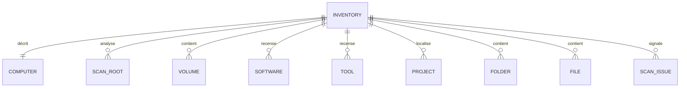

# Livrable 5 — Modèle SQLite réduit

> **Révision du 17 novembre 2026 (3ᵉ).** La vérification du 17/11 a fait deux corrections :
> la table `disk` est **fusionnée dans `volume`** (elle n'était pas indispensable → **10
> tables**), et la règle de comparaison est **durcie** : un disque dont le scan a été
> interrompu ne peut plus produire aucune suppression confirmée. Toujours : aucun hachage
> de chemin, aucune statistique pré-calculée, aucune rétention automatique.

---

## 1. Principes

| Principe | Traduction |
|---|---|
| Un fichier est identifié par son **chemin complet normalisé** | colonnes `folder_path` + `name`, jointure directe entre inventaires |
| La recherche doit être **servie par un index** | `ix_file_name` sur le nom, `ix_file_ext`, `ix_file_size` |
| Un résultat n'est jamais présenté comme exhaustif | statut porté par `scan_root` **et** par `scan_issue` |
| Les totaux se calculent à la demande | `SUM`/`COUNT` sur index, aucune table d'agrégats |
| L'utilisateur décide de ce qu'il garde | aucun mécanisme de purge automatique |
| Rien de personnel | aucun contenu, aucun hash de contenu |

Fichier : `%LOCALAPPDATA%\ATLAS PC\atlas.db`.

---

## 2. Les dix tables



| Table | Rôle | Volume attendu | Indispensable pour |
|---|---|---|---|
| `inventory` | un inventaire daté | 1 ligne par inventaire | historique, comparaison |
| `scan_root` | un disque analysé **et son statut** | 1-4 lignes | couverture, garde anti-fausse-suppression |
| `computer` | matériel principal + Windows | 1 ligne | rubrique Ordinateur |
| `volume` | volumes **et leur disque physique** | 1-4 lignes | rubrique Ordinateur, remplissage |
| `software` | logiciels installés | 100-400 lignes | rubrique Logiciels |
| `tool` | les 6 outils de développement | 6 lignes | rubrique Outils |
| `project` | projets Python / Node.js | dizaines | rubrique Développement |
| `folder` | dossiers et totaux | ~60 000 | arbre, totaux, comptage |
| `file` | fichiers (métadonnées seules) | ~400 000 | recherche, comparaison |
| `scan_issue` | zones non analysées, **une ligne par dossier** | dizaines à milliers | garde anti-fausse-suppression |

**Correction apportée le 17/11** : l'ancienne table `disk` (3 colonnes : index, modèle,
taille) est fusionnée dans `volume` (`disk_index`, `disk_model`, `disk_size_bytes`). Elle
n'était pas indispensable : la rubrique Ordinateur affiche « disques et volumes » à partir
des volumes, et la duplication du modèle sur 1 à 4 lignes ne coûte rien. Une table et une
jointure en moins. Contrepartie assumée : un disque physique **sans aucun volume monté**
n'apparaît plus (cas rare, sans effet sur les fonctions essentielles).

---

## 3. DDL

```sql
PRAGMA journal_mode = WAL;
PRAGMA synchronous  = NORMAL;
PRAGMA foreign_keys = ON;
PRAGMA cache_size   = -16000;   -- ~16 Mo : garde l'index des noms en cache
PRAGMA temp_store   = MEMORY;

-- 1. Inventaires ------------------------------------------------------------
CREATE TABLE inventory (
    id            INTEGER PRIMARY KEY,
    started_at    TEXT    NOT NULL,             -- ISO-8601 UTC
    finished_at   TEXT,
    status        TEXT    NOT NULL              -- running pendant le scan
                  CHECK (status IN ('running','complete','partial','cancelled')),
    app_version   TEXT    NOT NULL,
    roots_count   INTEGER NOT NULL DEFAULT 0,
    files_count   INTEGER NOT NULL DEFAULT 0,
    folders_count INTEGER NOT NULL DEFAULT 0,
    total_bytes   INTEGER NOT NULL DEFAULT 0,
    issues_count  INTEGER NOT NULL DEFAULT 0,
    note          TEXT
);

-- 2. Disques analysés : le statut par emplacement --------------------------
CREATE TABLE scan_root (
    id            INTEGER PRIMARY KEY,
    inventory_id  INTEGER NOT NULL REFERENCES inventory(id) ON DELETE CASCADE,
    path          TEXT    NOT NULL,             -- 'C:\', 'D:\'
    drive         TEXT    NOT NULL,             -- 'C:'
    label         TEXT,                         -- nom du volume
    status        TEXT    NOT NULL              -- voir § 3.1
                  CHECK (status IN ('running','complete','partial','cancelled','inaccessible')),
    files_count   INTEGER NOT NULL DEFAULT 0,
    folders_count INTEGER NOT NULL DEFAULT 0,
    total_bytes   INTEGER NOT NULL DEFAULT 0,
    issues_count  INTEGER NOT NULL DEFAULT 0,
    started_at    TEXT,
    finished_at   TEXT,
    error_message TEXT,                         -- si la racine n'a pas pu être ouverte
    UNIQUE (inventory_id, drive)
);

-- 3. Matériel principal et Windows ------------------------------------------
CREATE TABLE computer (
    inventory_id  INTEGER PRIMARY KEY REFERENCES inventory(id) ON DELETE CASCADE,
    manufacturer  TEXT, model TEXT,
    cpu_name      TEXT, cpu_cores INTEGER,
    cpu_threads   INTEGER,                      -- ajouté en v2 : processeurs logiques
    ram_bytes     INTEGER,                      -- mémoire installée
    ram_usable_bytes INTEGER,                   -- ajouté en v2 : mémoire utilisable
    gpu_name      TEXT,
    bios_vendor   TEXT, bios_version TEXT,
    os_name       TEXT, os_version TEXT, os_build TEXT,
    os_arch       TEXT, os_install_date TEXT
);

-- 4. Volumes et disques physiques (fusion de l'ancienne table `disk`) --------
CREATE TABLE volume (
    id              INTEGER PRIMARY KEY,
    inventory_id    INTEGER NOT NULL REFERENCES inventory(id) ON DELETE CASCADE,
    drive           TEXT,                       -- 'C:' ; NULL si volume non monté
    label           TEXT,
    file_system     TEXT,
    total_bytes     INTEGER,
    free_bytes      INTEGER,
    disk_index      INTEGER,                    -- disque physique (WMI Index)
    disk_model      TEXT,                       -- dupliqué par volume : 1 à 4 lignes
    disk_size_bytes INTEGER
);

-- 5. Logiciels installés ----------------------------------------------------
CREATE TABLE software (
    id               INTEGER PRIMARY KEY,
    inventory_id     INTEGER NOT NULL REFERENCES inventory(id) ON DELETE CASCADE,
    name             TEXT NOT NULL,
    version          TEXT,
    publisher        TEXT,
    install_location TEXT,
    install_date     TEXT
);

-- 6. Outils de développement ------------------------------------------------
CREATE TABLE tool (
    id           INTEGER PRIMARY KEY,
    inventory_id INTEGER NOT NULL REFERENCES inventory(id) ON DELETE CASCADE,
    kind         TEXT NOT NULL,                 -- python|pip|node|npm|git|tesseract
    path         TEXT,
    version      TEXT,
    status       TEXT NOT NULL                  -- found|not_found|failed
);

-- 7. Projets ----------------------------------------------------------------
CREATE TABLE project (
    id           INTEGER PRIMARY KEY,
    inventory_id INTEGER NOT NULL REFERENCES inventory(id) ON DELETE CASCADE,
    path         TEXT NOT NULL,
    kind         TEXT NOT NULL,                 -- python|node
    is_git       INTEGER NOT NULL DEFAULT 0
);

-- 8. Dossiers ---------------------------------------------------------------
CREATE TABLE folder (
    id           INTEGER PRIMARY KEY,
    inventory_id INTEGER NOT NULL REFERENCES inventory(id) ON DELETE CASCADE,
    parent_path  TEXT,                          -- NULL pour la racine d'un disque
    path         TEXT NOT NULL,                 -- chemin complet du dossier
    size_bytes   INTEGER NOT NULL DEFAULT 0,
    files_count  INTEGER NOT NULL DEFAULT 0,    -- fichiers directs
    dirs_count   INTEGER NOT NULL DEFAULT 0,    -- sous-dossiers directs
    modified_at  TEXT                           -- date du dossier, si disponible
);

-- 9. Fichiers ---------------------------------------------------------------
CREATE TABLE file (
    id           INTEGER PRIMARY KEY,
    inventory_id INTEGER NOT NULL REFERENCES inventory(id) ON DELETE CASCADE,
    folder_path  TEXT NOT NULL,                 -- dossier contenant
    name         TEXT NOT NULL,
    ext          TEXT,                          -- minuscule, sans point, '' si aucune
    size_bytes   INTEGER NOT NULL,
    modified_at  TEXT NOT NULL                  -- ISO-8601 UTC
);

-- 10. Zones non analysées : UNE LIGNE PAR DOSSIER EN ÉCHEC -------------------
CREATE TABLE scan_issue (
    id           INTEGER PRIMARY KEY,
    inventory_id INTEGER NOT NULL REFERENCES inventory(id) ON DELETE CASCADE,
    root_drive   TEXT,                          -- 'C:' : rattachement au disque
    path         TEXT NOT NULL,                 -- le dossier qui a échoué
    kind         TEXT NOT NULL                  -- voir § 3.2
                 CHECK (kind IN ('access_denied','io_error','path_too_long',
                                 'cancelled_before','unexpected')),
    code         INTEGER,                       -- code d'erreur .NET / Win32
    message      TEXT
);
```

> **Version 2 du schéma (17/11/2026).** Deux colonnes ont été ajoutées à `computer` :
> `cpu_threads` (les threads sont affichés à part des cœurs physiques) et
> `ram_usable_bytes` (la mémoire utilisable n'est pas la mémoire installée). C'est la
> **seule** entorse à la règle « aucune migration » : `CREATE TABLE IF NOT EXISTS` ne
> touche pas une table existante, donc `Database.EnsureColumn` vérifie `PRAGMA table_info`
> et exécute un `ALTER TABLE ... ADD COLUMN` si la colonne manque. Opération idempotente,
> sur deux colonnes nommées dans le code — pas de moteur de migration. `PRAGMA user_version`
> passe de 1 à 2 ; une base créée en v1 reste donc lisible sans être recréée.


### 3.1 Le statut d'un disque, et sa conséquence exacte

| Statut | Quand | Conséquence sur la comparaison |
|---|---|---|
| `running` | inventaire ou disque **en cours** de parcours | transitoire : une ligne `running` n'est jamais comparable, et elle est supprimée au démarrage suivant si la session a été interrompue |
| `complete` | parcours terminé, **aucune** zone en erreur | suppressions décidables dossier par dossier |
| `partial` | parcours terminé, **mais** au moins une zone en erreur | suppressions décidables dossier par dossier (la garde `scan_issue` s'applique) |
| `cancelled` | parcours **interrompu** par l'utilisateur | **aucune suppression confirmée** sur ce disque |
| `inaccessible` | racine refusée ou absente | **aucune suppression confirmée** sur ce disque |

**Cas particulier de l'étape 2.** Un inventaire qui ne contient que le matériel est clôturé
en `partial` : c'est le seul statut qui dise à la fois « quelque chose a été collecté » et
« ce n'est pas complet ». Il n'a aucune ligne `scan_root`, donc aucune suppression ne peut
en découler ; sa note dit noir sur blanc que les fichiers n'ont pas été parcourus.

> **Correction du 17/11 (mise en œuvre de l'étape 1).** Le statut `running` a été ajouté
> aux deux `CHECK` : une ligne doit exister pendant le parcours, et le schéma n'autorisait
> que des états finaux. La règle de comparaison est inchangée — `running` n'est ni
> `complete` ni `partial`, donc il ne peut produire aucune suppression confirmée.
>
> **Correction du 17/11.** La version précédente ne bloquait que `inaccessible` et
> `cancelled`, alors que le parcours annulé produisait un statut `partial` : un disque
> interrompu à mi-parcours pouvait donc faire apparaître comme « supprimés » tous les
> fichiers non encore visités. C'était exactement le défaut que le cahier des charges
> interdit. Les deux statuts sont maintenant distincts et la règle est sans ambiguïté :
> **seul un parcours terminé autorise à conclure à une suppression.**

### 3.2 Les natures d'incident

| `kind` | Origine |
|---|---|
| `access_denied` | `UnauthorizedAccessException` — ACL refusée |
| `io_error` | `IOException` — disque, secteur, fichier en cours |
| `path_too_long` | `PathTooLongException` |
| `cancelled_before` | dossier non visité parce que le parcours s'est arrêté avant lui |
| `unexpected` | toute autre exception |

`cancelled_before` sert à couvrir proprement le cas d'un parcours interrompu : chaque
dossier restant est signalé, en plus du statut `cancelled` du disque. Ceinture et
bretelles **volontaires** sur la règle la plus importante du cahier des charges.

### Index

```sql
CREATE INDEX ix_inventory_date  ON inventory(started_at DESC);

CREATE INDEX ix_software_name   ON software(inventory_id, name);
CREATE INDEX ix_tool_kind       ON tool(inventory_id, kind);
CREATE INDEX ix_project_path    ON project(inventory_id, path);

-- navigation dans l'arbre
CREATE INDEX ix_folder_path     ON folder(inventory_id, path COLLATE NOCASE);
CREATE INDEX ix_folder_parent   ON folder(inventory_id, parent_path COLLATE NOCASE);
CREATE INDEX ix_folder_size     ON folder(inventory_id, size_bytes DESC);

-- recherche et comparaison : l'index qui compte le plus
CREATE INDEX ix_file_name       ON file(inventory_id, name COLLATE NOCASE);
CREATE INDEX ix_file_key        ON file(inventory_id, folder_path COLLATE NOCASE,
                                             name COLLATE NOCASE);
CREATE INDEX ix_file_folder     ON file(inventory_id, folder_path COLLATE NOCASE);
CREATE INDEX ix_file_ext        ON file(inventory_id, ext, size_bytes DESC);
CREATE INDEX ix_file_size       ON file(inventory_id, size_bytes DESC);

CREATE INDEX ix_issue_root      ON scan_issue(inventory_id, root_drive);
CREATE INDEX ix_issue_path      ON scan_issue(inventory_id, path COLLATE NOCASE);
```

**Pourquoi `ix_file_name` est le plus important.** Une recherche par préfixe
(`LIKE 'fact%'`) est une recherche d'intervalle : instantanée. Une recherche par
sous-chaîne (`LIKE '%actu%'`) ne peut pas s'y ramener, mais **parcourt cet index** au
lieu de la table entière : quelques mégaoctets lus au lieu de 60, et les lignes complètes
ne sont lues que pour les 200 résultats affichés. C'est ce qui rend la recherche
acceptable **sans** index plein texte. Si la mesure impose FTS5 (voir
`07-architecture-cible.md` § 6.4), il s'ajoutera **une** table virtuelle, rien d'autre.

`COLLATE NOCASE` ne traite que l'ASCII — limite documentée, sans conséquence pratique
sur des noms de fichiers Windows.

---

## 4. Pourquoi « dossier + nom » plutôt qu'un chemin unique

Deux colonnes `folder_path` + `name` **sont** le chemin complet normalisé, avec deux
avantages :

- on n'écrit pas 70 caractères de préfixe 400 000 fois pour rien ;
- la jointure entre deux inventaires et la navigation dans l'arbre n'ont besoin
  d'aucune fonction de chaîne, donc d'aucun calcul par ligne.

Aucune autre clé n'est nécessaire : pas de hachage, pas d'`id` de dossier dans la table
des fichiers.

---

## 5. Les requêtes de la rubrique Fichiers

Toutes sont **paramétrées** et **plafonnées**.

### 5.1 Liste des disques d'un inventaire

```sql
SELECT drive, label, status, files_count, folders_count, total_bytes, issues_count,
       error_message
FROM scan_root
WHERE inventory_id = :inv
ORDER BY drive;
```

C'est la source du bandeau de couverture : aucun total ne s'affiche sans ces statuts.

### 5.2 Enfants d'un dossier (dépliage de l'arbre)

```sql
SELECT id, path, size_bytes, files_count, dirs_count
FROM folder
WHERE inventory_id = :inv
  AND parent_path = :dossier            -- pour les racines : parent_path IS NULL
ORDER BY size_bytes DESC
LIMIT 500;
```

### 5.3 Contenu d'un dossier

```sql
-- sous-dossiers
SELECT path, size_bytes, files_count, dirs_count FROM folder
WHERE inventory_id = :inv AND parent_path = :dossier
ORDER BY size_bytes DESC;

-- fichiers (page de 200)
SELECT id, name, ext, size_bytes, modified_at
FROM file
WHERE inventory_id = :inv AND folder_path = :dossier
ORDER BY name
LIMIT 200 OFFSET :decalage;
```

### 5.4 Fil d'Ariane

Remonter `parent_path` de proche en proche : une requête courte par niveau (au plus une
dizaine). Aucune récursion SQL.

### 5.5 Recherche : trois cas, deux stratégies

| Saisie | Requête | Coût |
|---|---|---|
| **nom exact** (`rapport-2026.pdf`) | `name = :saisie COLLATE NOCASE` — court-circuit | index, **< 20 ms** |
| **préfixe** (`rapport`) | `name LIKE :saisie \|\| '%'` | intervalle d'index, **< 100 ms** |
| **sous-chaîne** (`apport`) | `name LIKE '%' \|\| :saisie \|\| '%'` | parcours de l'index des noms, **< 1,5 s** |

```sql
-- court-circuit du nom exact : exécuté d'abord, sans parcours
SELECT id, name, ext, size_bytes, modified_at, folder_path
FROM file
WHERE inventory_id = :inv AND name = :saisie COLLATE NOCASE;

-- si (et seulement si) le court-circuit ne renvoie rien : parcours
SELECT id, name, ext, size_bytes, modified_at, folder_path
FROM file
WHERE inventory_id = :inv AND name LIKE :motif      -- 'rapport%' ou '%apport%'
ORDER BY name
LIMIT 200 OFFSET :decalage;

-- nombre total, pour « x résultats (200 affichés) »
SELECT COUNT(*) FROM file WHERE inventory_id = :inv AND name LIKE :motif;
```

> Le court-circuit du nom exact est une **optimisation interne de la requête**, pas une
> fonction d'interface : l'utilisateur tape un nom, il obtient la réponse. C'est aussi ce
> qui permet de dire, chiffre en main, que la recherche par nom exact est instantanée.

### 5.6 Recherche avec filtres

```sql
SELECT id, name, ext, size_bytes, modified_at, folder_path
FROM file
WHERE inventory_id = :inv
  AND name LIKE :motif                                  -- si saisie
  AND (:extSansFiltre = 1 OR ext IN (SELECT value FROM json_each(:exts)))
  AND size_bytes BETWEEN :tailleMin AND :tailleMax
  AND modified_at BETWEEN :dateDebut AND :dateFin
  AND (:sousArbre = 0 OR folder_path = :dossier
                        OR folder_path LIKE :dossier || '\%' ESCAPE '\')
ORDER BY <colonne autorisée> <ASC|DESC>, name ASC   -- nom de colonne pris dans une
                                                    -- table blanche du code
LIMIT 200 OFFSET :decalage;
```

> Le `IN (SELECT value FROM json_each(:exts))` évite de construire du SQL par
> concaténation : la liste d'extensions est passée en **un seul paramètre JSON**. Si
> `json_each` n'est pas disponible, repli sur une liste de paramètres `IN (?,?,?)`
> plafonnée à 30 extensions — sans effet sur le schéma.

### 5.7 Le tableau de bord (à la demande, sans table d'agrégats)

```sql
SELECT ext, COUNT(*) AS fichiers, SUM(size_bytes) AS octets
FROM file WHERE inventory_id = :id GROUP BY ext ORDER BY octets DESC;

SELECT path, size_bytes FROM folder
WHERE inventory_id = :id AND parent_path = :racine
ORDER BY size_bytes DESC LIMIT 8;

SELECT folder_path, name, size_bytes FROM file
WHERE inventory_id = :id ORDER BY size_bytes DESC LIMIT 20;
```

Chacune doit rester sous **1 s** sur 400 000 lignes. Sinon : filtrer, plafonner, ou ne pas
lancer la requête avant l'ouverture de la vue — **jamais** réintroduire des tables
d'agrégats.

### 5.8 La recherche ne lit jamais le disque

Toutes les requêtes ci-dessus portent sur `:inv`, l'inventaire **déjà en base**. Aucune
d'appel à `System.IO` n'existe dans `SearchQueries` ni `BrowseQueries` : une recherche est
servie par SQLite, sans rescanner quoi que ce soit. Le seul accès disque de la rubrique
Fichiers est la **vérification d'existence** au moment d'ouvrir un élément
(`07-architecture-cible.md` § 6.6). C'est vérifié par un test (§ 9, point 7).

---

## 6. Comparaison : quatre résultats

La comparaison porte sur les disques **communs** aux deux inventaires. Un disque présent
dans un seul des deux est listé comme « non comparable », jamais comparé en silence : un
disque entier ne peut pas passer pour supprimé.

### 6.1 Fichiers ajoutés

```sql
SELECT b.folder_path, b.name, b.ext, b.size_bytes, b.modified_at
FROM file b
WHERE b.inventory_id = :b
  AND NOT EXISTS (
      SELECT 1 FROM file a
      WHERE a.inventory_id = :a
        AND a.folder_path = b.folder_path COLLATE NOCASE
        AND a.name        = b.name        COLLATE NOCASE)
ORDER BY b.size_bytes DESC
LIMIT 500;
```

### 6.2 Fichiers modifiés

```sql
SELECT b.folder_path, b.name, a.size_bytes AS taille_avant, b.size_bytes AS taille_apres,
       a.modified_at AS date_avant, b.modified_at AS date_apres
FROM file b
JOIN file a
  ON a.inventory_id = :a
 AND a.folder_path  = b.folder_path COLLATE NOCASE
 AND a.name         = b.name        COLLATE NOCASE
WHERE b.inventory_id = :b
  AND (a.size_bytes <> b.size_bytes OR a.modified_at <> b.modified_at)
ORDER BY ABS(b.size_bytes - a.size_bytes) DESC
LIMIT 500;
```

### 6.3 Fichiers supprimés — la garde, version durcie

> **Règle** : ne jamais annoncer la disparition d'un fichier lorsque la zone
> correspondante n'a pas été correctement analysée.

Un fichier n'est déclaré **supprimé** que si **les trois** conditions sont réunies :

1. le disque est `complete` ou `partial` dans l'inventaire récent (donc le parcours est
   **allé au bout**) ;
2. aucune ligne `scan_issue` ne couvre son dossier (ni le dossier lui-même, ni un
   ancêtre) ;
3. le fichier est absent de l'inventaire récent.

Sinon il devient une **« disparition non vérifiable »**, avec la zone responsable.

```sql
WITH candidats AS (
    SELECT a.folder_path, a.name, a.ext, a.size_bytes, a.modified_at,
           substr(a.folder_path, 1, 2) AS root_drive      -- 'C:' déduit du chemin
    FROM file a
    WHERE a.inventory_id = :a
      AND NOT EXISTS (
          SELECT 1 FROM file b
          WHERE b.inventory_id = :b
            AND b.folder_path = a.folder_path COLLATE NOCASE
            AND b.name        = a.name        COLLATE NOCASE)
)
SELECT c.folder_path, c.name, c.ext, c.size_bytes, c.modified_at,
       CASE WHEN
            -- condition 1 : le disque doit avoir été parcouru jusqu'au bout
            NOT EXISTS (
                SELECT 1 FROM scan_root r
                WHERE r.inventory_id = :b AND r.drive = c.root_drive
                  AND r.status IN ('complete','partial')
            )
            -- condition 2 : aucune zone en erreur ne couvre ce dossier
            OR EXISTS (
                SELECT 1 FROM scan_issue s
                WHERE s.inventory_id = :b
                  AND ( c.folder_path = s.path COLLATE NOCASE
                     OR c.folder_path LIKE s.path || '\%' ESCAPE '\' )
            )
            THEN 0 ELSE 1 END AS suppression_confirmee
FROM candidats c
ORDER BY c.size_bytes DESC
LIMIT 500;
```

- `suppression_confirmee = 1` → « Fichiers supprimés » ;
- `suppression_confirmee = 0` → « Disparitions non vérifiables », avec la zone
  responsable (disque non parcouru ou dossier en erreur).

Le nombre de lignes de `scan_issue` étant petit (dizaines à quelques milliers), le test de
préfixe reste rapide.

### 6.4 Un renommage est une suppression plus un ajout — et rien d'autre

**Décision de V1, explicitement assumée** : ATLAS PC n'essaie pas de reconnaître les
déplacements et renommages.

- `C:\Docs\rapport.pdf` renommé en `C:\Docs\rapport-final.pdf` apparaît comme
  **1 fichier supprimé** et **1 fichier ajouté** ;
- déplacé de `C:\Docs` vers `D:\Sauvegardes` : même chose, **1 supprimé** + **1 ajouté** ;
- aucune heuristique sur la taille, la date, le nom approchant ou le contenu.

Trois raisons : reconnaître un déplacement de façon fiable est un problème difficile (il
faudrait apparier des millions de lignes sur des critères ambigus) ; le résultat serait
parfois faux ; et le cahier des charges demande quatre chiffres — ajoutés, supprimés,
modifiés, espace — pas une reconstruction d'historique de mouvements.

Conséquence affichée dans l'interface : l'onglet **Supprimés** porte la mention
« un déplacement ou un renommage apparaît ici comme une suppression, et dans l'onglet
Ajoutés ». C'est écrit, donc ce n'est pas une surprise.

### 6.5 Évolution de l'espace occupé

```sql
SELECT b.total_bytes - a.total_bytes AS delta_total,
       a.total_bytes AS avant, b.total_bytes AS apres,
       b.files_count - a.files_count AS delta_fichiers
FROM inventory a, inventory b
WHERE a.id = :a AND b.id = :b;

SELECT rb.drive, ra.total_bytes AS avant, rb.total_bytes AS apres,
       rb.total_bytes - COALESCE(ra.total_bytes, 0) AS delta
FROM scan_root rb
LEFT JOIN scan_root ra ON ra.inventory_id = :a AND ra.drive = rb.drive
WHERE rb.inventory_id = :b
ORDER BY rb.drive;
```

---

## 7. Volume et rétention

### 7.1 Taille estimée, par inventaire de 400 000 fichiers

| Table | Lignes | Taille estimée |
|---|---|---|
| `file` (données) | 400 000 | 45-60 Mo |
| `file` — index (`name`, `key`, `folder`, `ext`, `size`) | | 30-45 Mo |
| `folder` | 60 000 | 6-9 Mo |
| `software`, `tool`, `project` | < 500 | < 1 Mo |
| `scan_root`, `computer`, `volume`, `scan_issue` | < 100 | < 100 Ko |
| **Total** | | **≈ 85-110 Mo** |

Le surcoût par rapport à une base sans index de recherche vient de ces index : c'est le
prix de la fonction centrale, et il reste inférieur à un dixième de la taille analysée.

### 7.2 Aucune rétention automatique

- l'utilisateur voit la liste des inventaires, avec **date, disques, nombre de fichiers,
  taille en base** ;
- il supprime celui qu'il veut (`DELETE FROM inventory WHERE id = ?`, cascade) ;
- l'interface affiche la taille du fichier `atlas.db` et un avertissement au-delà de
  10 inventaires — **jamais** une suppression automatique.

Aucun `VACUUM` automatique : l'espace libéré est réutilisé par SQLite.

---

## 8. Ce que la base ne contient jamais

| Absent | Raison |
|---|---|
| contenu de fichier | règle du cahier des charges |
| hash de contenu, index plein texte **en V1** | hors périmètre (FTS5 seulement si la mesure l'exige) |
| table de correspondance des déplacements | décision § 6.4 : un renommage = suppression + ajout |
| taille allouée, taille de cluster | hors V1 |
| attributs de fichier | hors V1 |
| partitions, barrettes mémoire, SMART, réseau | hors V1 |
| icônes, aperçus | volumineux, inutiles |
| statistiques pré-calculées | recalculées à la demande |
| historique de rétention | supprimé par l'utilisateur, pas par le logiciel |

---

## 9. Points à vérifier à l'étape 3

1. **Compatibilité** de `System.Data.SQLite.Core` avec `net48` : création, 100 000
   insertions, agrégation. (Repli : `Microsoft.Data.Sqlite`.)
2. **Version de SQLite embarquée** : `json_each` disponible ? `trigram` disponible (au
   cas où FTS5 deviendrait nécessaire) ?
3. **Ordre de création des index** : si l'insertion est le goulot, créer `ix_file_name`
   et `ix_file_key` **après** le scan.
4. **Les trois recherches** (exact, préfixe, sous-chaîne) sur 100 000 / 400 000 /
   1 000 000 de fichiers, à froid et à chaud. Seuils : 20 ms / 100 ms / 1,5 s.
5. **Optimisation de `LIKE` avec paramètre lié** sur `folder_path` (filtre Emplacement) :
   le plan d'exécution doit utiliser `ix_file_folder`. Vérifier avec `EXPLAIN QUERY PLAN`.
6. **Durée des trois requêtes du tableau de bord**, et d'une page d'un dossier de
   5 000 fichiers (`C:\Windows\System32`).
7. **Aucune lecture disque pendant une recherche** : test automatisé (dossier scanné
   supprimé après le scan, recherche toujours concluante).
8. **Taille réelle** d'une base d'inventaire, à comparer au § 7.1.
