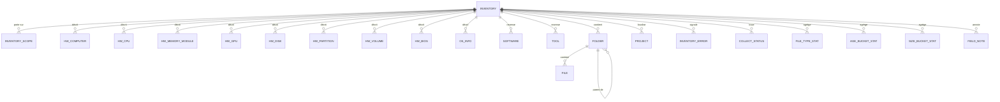

# Livrable 5 — Modèle SQLite et stratégie d'historique

Objectif : conserver **plusieurs inventaires datés** et répondre en SQL à
« quels fichiers sont apparus, ont disparu, ont changé, et comment le stockage a
évolué », **sans jamais stocker le contenu des fichiers personnels**.

---

## 1. Principes de conception

| Principe | Conséquence concrète |
|---|---|
| Un inventaire n'est jamais modifié après clôture | les lignes sont immuables ; seule la purge de rétention les supprime |
| Aucune image binaire | tout est en tables, donc interrogeable sans redévelopper le format |
| Pas de duplication de chemin | `folder` porte le nom et le parent ; `file` porte `folder_id` + `name` |
| Identité stable entre inventaires | `path_hash` (64 bits) sur dossier et fichier, calculé sur le chemin normalisé **préfixé par la racine de portée** |
| Écriture par lots | transactions de 2 000 lignes, `synchronous = NORMAL` |
| Tout ce qui n'a pas pu être lu est enregistré | table `inventory_error` + statut d'inventaire `partial` |
| Aucun contenu, aucun hash de contenu | seules des métadonnées : nom, taille, dates, attributs, extension |

**Version minimale de SQLite visée** : 3.30 ou plus (aucune table `STRICT`, aucune
colonne générée, aucune extension propriétaire, afin de rester compatible avec
n'importe quel provider).

---

## 2. Schéma simplifié



Légende : `INVENTORY` est la racine de l'historique ; tout le reste est rattaché par
`inventory_id` et supprimé en cascade.

---

## 3. DDL complet (schéma cible, à valider au jalon M3)

> Le DDL est fourni à titre de **spécification** : il décrit les tables, colonnes,
> contraintes et index attendus. Aucun fichier de code n'est créé à ce stade.

### 3.1 Racine de l'historique

```sql
PRAGMA journal_mode = WAL;
PRAGMA synchronous  = NORMAL;
PRAGMA foreign_keys = ON;
PRAGMA cache_size   = -8000;   -- ~8 Mo
PRAGMA temp_store   = MEMORY;

CREATE TABLE schema_version (
    version      INTEGER NOT NULL,
    applied_at   TEXT    NOT NULL
);

CREATE TABLE inventory (
    id                 INTEGER PRIMARY KEY,
    uuid               TEXT    NOT NULL UNIQUE,
    started_at         TEXT    NOT NULL,          -- ISO-8601 UTC
    finished_at        TEXT,
    status             TEXT    NOT NULL            -- running|complete|partial|cancelled|failed
                       CHECK (status IN ('running','complete','partial','cancelled','failed')),
    app_version        TEXT    NOT NULL,
    mode               TEXT    NOT NULL            -- full|light
                       CHECK (mode IN ('full','light')),
    host_name          TEXT,
    duration_ms        INTEGER,
    files_count        INTEGER,
    folders_count      INTEGER,
    bytes_logical      INTEGER,
    bytes_allocated    INTEGER,
    errors_count       INTEGER,
    error_folders_count INTEGER,
    is_baseline        INTEGER NOT NULL DEFAULT 0, -- inventaire de référence choisi par l'utilisateur
    note               TEXT
);

CREATE INDEX ix_inventory_date ON inventory(started_at DESC);

CREATE TABLE inventory_scope (
    id            INTEGER PRIMARY KEY,
    inventory_id  INTEGER NOT NULL REFERENCES inventory(id) ON DELETE CASCADE,
    kind          TEXT    NOT NULL CHECK (kind IN ('volume','folder')),
    root_path     TEXT    NOT NULL,   -- ex. 'C:\' ou 'D:\Projets'
    root_path_key TEXT    NOT NULL,   -- normalisé minuscule, pour le hachage
    volume_label  TEXT,
    file_system   TEXT,
    cluster_size  INTEGER,
    is_network    INTEGER NOT NULL DEFAULT 0,
    is_removable  INTEGER NOT NULL DEFAULT 0
);

CREATE INDEX ix_scope_inventory ON inventory_scope(inventory_id);
```

### 3.2 Matériel et Windows

Tables **explicites** (et non un modèle clé/valeur générique) : elles sont petites,
lisibles, et surtout **comparables** d'un inventaire à l'autre par simple jointure.

```sql
CREATE TABLE hw_computer (
    inventory_id     INTEGER PRIMARY KEY REFERENCES inventory(id) ON DELETE CASCADE,
    manufacturer     TEXT, model TEXT, family TEXT, sku TEXT,
    chassis_type     TEXT,
    ram_total_bytes  INTEGER,
    is_virtual_machine INTEGER            -- 0|1|NULL
);

CREATE TABLE hw_cpu (
    inventory_id  INTEGER PRIMARY KEY REFERENCES inventory(id) ON DELETE CASCADE,
    name          TEXT, manufacturer TEXT,
    cores         INTEGER, logical_processors INTEGER,
    max_clock_mhz INTEGER, socket TEXT
);

CREATE TABLE hw_memory_module (
    id            INTEGER PRIMARY KEY,
    inventory_id  INTEGER NOT NULL REFERENCES inventory(id) ON DELETE CASCADE,
    slot          TEXT,
    capacity_bytes INTEGER,
    speed_mhz     INTEGER,
    manufacturer  TEXT,
    part_number   TEXT
);

CREATE TABLE hw_gpu (
    id            INTEGER PRIMARY KEY,
    inventory_id  INTEGER NOT NULL REFERENCES inventory(id) ON DELETE CASCADE,
    name          TEXT, driver_version TEXT,
    vram_bytes    INTEGER,
    vram_is_approx INTEGER,               -- 1 quand WMI ne permet pas de garantir la valeur
    resolution    TEXT
);

CREATE TABLE hw_disk (
    id            INTEGER PRIMARY KEY,
    inventory_id  INTEGER NOT NULL REFERENCES inventory(id) ON DELETE CASCADE,
    disk_index    INTEGER,
    model         TEXT, interface_type TEXT,
    size_bytes    INTEGER,
    media_type    TEXT,                   -- HDD|SSD|Unknown (souvent Unknown en WMI)
    serial_redacted TEXT
);

CREATE TABLE hw_partition (
    id            INTEGER PRIMARY KEY,
    inventory_id  INTEGER NOT NULL REFERENCES inventory(id) ON DELETE CASCADE,
    disk_index    INTEGER, partition_number INTEGER,
    size_bytes    INTEGER, type_name TEXT,
    is_boot       INTEGER, is_system INTEGER
);

CREATE TABLE hw_volume (
    id            INTEGER PRIMARY KEY,
    inventory_id  INTEGER NOT NULL REFERENCES inventory(id) ON DELETE CASCADE,
    mount_point   TEXT, label TEXT, file_system TEXT,
    total_bytes   INTEGER, free_bytes INTEGER,
    cluster_size  INTEGER, is_removable INTEGER
);

CREATE TABLE hw_bios (
    inventory_id  INTEGER PRIMARY KEY REFERENCES inventory(id) ON DELETE CASCADE,
    manufacturer  TEXT, version TEXT, release_date TEXT,
    smbios_version TEXT
);

CREATE TABLE os_info (
    inventory_id     INTEGER PRIMARY KEY REFERENCES inventory(id) ON DELETE CASCADE,
    product_name     TEXT, edition TEXT, edition_id TEXT,
    display_version  TEXT, build TEXT, ubr INTEGER,
    architecture     TEXT, install_date TEXT,
    last_boot        TEXT, locale TEXT,
    registered_owner_redacted TEXT
);
```

### 3.3 Statut de collecte et annotations de champ

Deux mécanismes complémentaires, inspirés de `docs/DATA_MODEL.md` de System
Inspector mais allégés :

```sql
-- Une ligne par (catégorie, source) : à quoi on a eu accès, en combien de temps.
CREATE TABLE collect_status (
    id           INTEGER PRIMARY KEY,
    inventory_id INTEGER NOT NULL REFERENCES inventory(id) ON DELETE CASCADE,
    category     TEXT    NOT NULL,     -- hardware|os|software|tools|files|projects
    source       TEXT    NOT NULL,     -- ex. 'Win32_VideoController'
    status       TEXT    NOT NULL,     -- Available|NotAvailable|NotSupported|PermissionDenied|
                                       -- QueryFailed|InvalidValue|NotApplicable|Timeout
    message      TEXT,
    error_code   INTEGER,
    duration_ms  INTEGER
);

CREATE INDEX ix_status_inventory ON collect_status(inventory_id, category);

-- Annotations rares : uniquement les champs qui ne sont pas simplement « lus ».
CREATE TABLE field_note (
    id           INTEGER PRIMARY KEY,
    inventory_id INTEGER NOT NULL REFERENCES inventory(id) ON DELETE CASCADE,
    category     TEXT    NOT NULL,
    item_key     TEXT,                 -- ex. 'gpu:1', 'volume:C:'
    field        TEXT    NOT NULL,
    state        TEXT    NOT NULL,     -- Unavailable|Approx|Inferred|Redacted
    message      TEXT
);
```

Justification de ce choix à deux niveaux : la table `collect_status` suffit dans 95 %
des cas et coûte ~20 lignes par inventaire ; `field_note` n'est remplie que pour les
valeurs douteuses. On obtient la traçabilité de System Inspector **sans** payer une
ligne par champ.

### 3.4 Logiciels et outils

```sql
CREATE TABLE software (
    id               INTEGER PRIMARY KEY,
    inventory_id     INTEGER NOT NULL REFERENCES inventory(id) ON DELETE CASCADE,
    identity         TEXT    NOT NULL,   -- clé de registre normalisée, ou 'portable:<chemin>'
    name             TEXT    NOT NULL,
    version          TEXT,
    publisher        TEXT,
    install_location TEXT,
    install_date     TEXT,
    estimated_size_kb INTEGER,
    architecture     TEXT,               -- x86|x64|AnyCPU|Unknown
    source           TEXT NOT NULL,       -- registry-msi|registry-exe|store|portable|shortcut
    confidence       TEXT NOT NULL DEFAULT 'high',  -- high|medium|low
    is_update        INTEGER NOT NULL DEFAULT 0
);

CREATE UNIQUE INDEX ux_software_identity ON software(inventory_id, identity);
CREATE INDEX ix_software_name ON software(inventory_id, name);

CREATE TABLE tool (
    id               INTEGER PRIMARY KEY,
    inventory_id     INTEGER NOT NULL REFERENCES inventory(id) ON DELETE CASCADE,
    kind             TEXT    NOT NULL,   -- python|pip|node|npm|git|tesseract
    path             TEXT,
    version          TEXT,
    detection_method TEXT,               -- path|known-folder|registry|file-version|command
    status           TEXT    NOT NULL,   -- found|not-found|inaccessible|failed
    message          TEXT
);

CREATE INDEX ix_tool_kind ON tool(inventory_id, kind);
```

`identity` est la clé de comparaison entre inventaires. Elle est **textuelle et
stable** : chemin de clé de registre normalisé (minuscules, `WOW6432Node` conservé)
pour les logiciels installés, `portable:<chemin>` pour les autres. On évite ainsi
qu'une simple variation de casse ou de version crée une fausse nouveauté.

### 3.5 Dossiers et fichiers

```sql
CREATE TABLE folder (
    id             INTEGER PRIMARY KEY,
    inventory_id   INTEGER NOT NULL REFERENCES inventory(id) ON DELETE CASCADE,
    parent_id      INTEGER REFERENCES folder(id),   -- NULL pour la racine de portée
    name           TEXT    NOT NULL,
    depth          INTEGER NOT NULL,
    path_hash      INTEGER,                          -- 64 bits, voir § 3.6
    size_bytes     INTEGER NOT NULL DEFAULT 0,
    allocated_bytes INTEGER,
    files_count    INTEGER NOT NULL DEFAULT 0,      -- fichiers du sous-arbre
    folders_count  INTEGER NOT NULL DEFAULT 0,
    last_write     TEXT,
    error_code     INTEGER,                          -- non NULL si énumération impossible
    is_reparse     INTEGER NOT NULL DEFAULT 0
);

CREATE INDEX ix_folder_parent ON folder(inventory_id, parent_id);
CREATE INDEX ix_folder_hash   ON folder(inventory_id, path_hash);
CREATE INDEX ix_folder_size   ON folder(inventory_id, size_bytes DESC);

CREATE TABLE file (
    id              INTEGER PRIMARY KEY,
    inventory_id    INTEGER NOT NULL REFERENCES inventory(id) ON DELETE CASCADE,
    folder_id       INTEGER NOT NULL REFERENCES folder(id) ON DELETE CASCADE,
    name            TEXT    NOT NULL,
    ext             TEXT,                 -- minuscule, sans point, '' si aucune
    size_bytes      INTEGER NOT NULL,
    allocated_bytes INTEGER,
    mtime           TEXT    NOT NULL,     -- ISO-8601 UTC
    attributes      INTEGER,
    path_hash       INTEGER               -- 64 bits, voir § 3.6
);

CREATE INDEX ix_file_folder ON file(inventory_id, folder_id);
CREATE INDEX ix_file_hash   ON file(inventory_id, path_hash);
CREATE INDEX ix_file_ext    ON file(inventory_id, ext, size_bytes DESC);
```

Notes :
- `folder.size_bytes` est la taille du sous-arbre (comme `TotalSize` chez
  NeoTreescan), `folder.allocated_bytes` l'espace occupé. Le détail par dossier
  direct se déduit de la somme de ses fichiers.
- `folder.error_code` matérialise la règle « signaler les zones non analysées » au
  niveau du dossier lui-même, en plus de `inventory_error`.
- `file.attributes` conserve les attributs Win32 utiles (caché, système, lecture
  seule) sans dupliquer les dates.

### 3.6 Pourquoi un `path_hash`

La comparaison entre deux inventaires exige d'apparier **le même fichier** dans deux
inventaires différents. Les `folder_id` diffèrent d'un inventaire à l'autre : il faut
donc une clé indépendante des identifiants.

`path_hash` = FNV-1a 64 bits de `lower(root_path_key + chemin_relatif)`, calculé
pendant le scan (le chemin du dossier courant est déjà en main, le coût est nul).

- 64 bits ⇒ une collision accidentelle est improbable (de l'ordre de 10⁻⁹ pour
  400 000 chemins) ;
- **la jointure inclut aussi `name`**, ce qui élimine complètement le risque de faux
  appariement ;
- le hachage intègre la **racine de portée**, donc un fichier `C:\a.txt` et un fichier
  `D:\a.txt` ne se rencontrent jamais.

Alternative écartée : reconstruire le chemin par CTE récursive à chaque comparaison
(400 000 lignes × 2 inventaires) — correct mais lent et complexe, pour économiser
8 octets par ligne.

### 3.7 Agrégats précalculés

Sur un disque mécanique, un `GROUP BY` sur 400 000 lignes à chaque ouverture du
tableau de bord se sent. Trois petites tables sont donc calculées en fin d'inventaire :

```sql
CREATE TABLE file_type_stat (
    inventory_id INTEGER NOT NULL REFERENCES inventory(id) ON DELETE CASCADE,
    ext          TEXT    NOT NULL,
    files_count  INTEGER NOT NULL,
    size_bytes   INTEGER NOT NULL,
    PRIMARY KEY (inventory_id, ext)
);

CREATE TABLE age_bucket_stat (
    inventory_id INTEGER NOT NULL REFERENCES inventory(id) ON DELETE CASCADE,
    bucket       TEXT    NOT NULL,   -- '<7j','7-30j','30-90j','90-365j','1-2a','>2a'
    files_count  INTEGER NOT NULL,
    size_bytes   INTEGER NOT NULL,
    PRIMARY KEY (inventory_id, bucket)
);

CREATE TABLE size_bucket_stat (
    inventory_id INTEGER NOT NULL REFERENCES inventory(id) ON DELETE CASCADE,
    bucket       TEXT    NOT NULL,   -- '<4K','4K-1M','1M-100M','100M-1G','1G-10G','>10G'
    files_count  INTEGER NOT NULL,
    size_bytes   INTEGER NOT NULL,
    PRIMARY KEY (inventory_id, bucket)
);
```

Coût : quelques centaines de lignes au total. Bénéfice : le tableau de bord s'ouvre
sans attendre.

### 3.8 Projets et erreurs

```sql
CREATE TABLE project (
    id           INTEGER PRIMARY KEY,
    inventory_id INTEGER NOT NULL REFERENCES inventory(id) ON DELETE CASCADE,
    folder_id    INTEGER REFERENCES folder(id) ON DELETE SET NULL,
    path         TEXT    NOT NULL,
    name         TEXT    NOT NULL,
    kinds        TEXT    NOT NULL,    -- 'node', 'python', 'dotnet'… séparés par virgule
    markers      TEXT,                 -- 'package.json;.git'
    is_git_repo  INTEGER NOT NULL DEFAULT 0,
    confidence   TEXT    NOT NULL DEFAULT 'high'
);

CREATE INDEX ix_project_inventory ON project(inventory_id);

CREATE TABLE inventory_error (
    id           INTEGER PRIMARY KEY,
    inventory_id INTEGER NOT NULL REFERENCES inventory(id) ON DELETE CASCADE,
    category     TEXT    NOT NULL,   -- files|hardware|software|tools|projects
    path         TEXT,
    win32_code   INTEGER,
    message      TEXT,
    occurrences  INTEGER NOT NULL DEFAULT 1   -- erreurs identiques agrégées
);

CREATE INDEX ix_error_inventory ON inventory_error(inventory_id, category);
```

---

## 4. Requêtes de comparaison (le cœur du livrable 7 du cahier des charges)

### 4.1 Fichiers ajoutés

```sql
SELECT t.name, f.size_bytes, f.mtime
FROM file t
JOIN folder f ON f.id = t.folder_id
WHERE t.inventory_id = :target
  AND NOT EXISTS (
      SELECT 1 FROM file b
      WHERE b.inventory_id = :baseline
        AND b.path_hash = t.path_hash
        AND b.name = t.name)
ORDER BY f.size_bytes DESC
LIMIT 500;
```

### 4.2 Fichiers disparus

```sql
SELECT b.name, f.size_bytes, f.mtime
FROM file b
JOIN folder f ON f.id = b.folder_id
WHERE b.inventory_id = :baseline
  AND NOT EXISTS (
      SELECT 1 FROM file t
      WHERE t.inventory_id = :target
        AND t.path_hash = b.path_hash
        AND t.name = b.name)
ORDER BY f.size_bytes DESC
LIMIT 500;
```

### 4.3 Fichiers modifiés

```sql
SELECT t.name, b.size_bytes AS taille_avant, t.size_bytes AS taille_apres,
       b.mtime AS date_avant, t.mtime AS date_apres
FROM file t
JOIN file b
  ON b.inventory_id = :baseline
 AND b.path_hash    = t.path_hash
 AND b.name         = t.name
WHERE t.inventory_id = :target
  AND (b.size_bytes <> t.size_bytes OR b.mtime <> t.mtime)
ORDER BY ABS(t.size_bytes - b.size_bytes) DESC
LIMIT 500;
```

### 4.4 Évolution du stockage par dossier

```sql
SELECT tf.name, bf.size_bytes AS avant, tf.size_bytes AS apres,
       (tf.size_bytes - bf.size_bytes) AS delta
FROM folder tf
JOIN folder bf
  ON bf.inventory_id = :baseline
 AND bf.path_hash    = tf.path_hash
WHERE tf.inventory_id = :target
  AND tf.depth <= 2
ORDER BY ABS(delta) DESC
LIMIT 100;
```

### 4.5 Logiciels et outils

```sql
-- Apparus / disparus / changés de version
SELECT
    COALESCE(t.name, b.name)      AS nom,
    b.version                     AS version_avant,
    t.version                     AS version_apres,
    CASE WHEN b.id IS NULL THEN 'ajouté'
         WHEN t.id IS NULL THEN 'disparu'
         ELSE 'version modifiée' END AS changement
FROM software t
LEFT JOIN software b
       ON b.inventory_id = :baseline
      AND b.identity     = t.identity
WHERE t.inventory_id = :target
UNION ALL
SELECT b.name, b.version, NULL, 'disparu'
FROM software b
WHERE b.inventory_id = :baseline
  AND NOT EXISTS (SELECT 1 FROM software t
                  WHERE t.inventory_id = :target AND t.identity = b.identity);
```

Le même modèle s'applique aux `tool` (comparaison sur `kind` + `path`).

### 4.6 Coût attendu

| Opération | Volume | Index utilisé | Estimation |
|---|---|---|---|
| Ajoutés / disparus | 2 × 400 000 lignes | `ix_file_hash` | < 2 s |
| Modifiés | 400 000 appariements | `ix_file_hash` | < 3 s |
| Évolution par dossier | ~60 000 lignes | `ix_folder_hash` | < 1 s |
| Logiciels | quelques centaines | `ux_software_identity` | < 100 ms |

Ces valeurs sont des **estimations à valider au jalon M6** ; elles supposent que
l'inventaire comparé est entièrement détaillé.

---

## 5. Volume et rétention

### 5.1 Estimation de taille (par inventaire détaillé)

| Table | Lignes (~400 000 fichiers / 60 000 dossiers) | Taille estimée |
|---|---|---|
| `file` | 400 000 | 35-50 Mo (dont index) |
| `folder` | 60 000 | 6-9 Mo |
| `software` | 100-400 | < 1 Mo |
| `tool`, `project`, `inventory_error` | dizaines | < 1 Mo |
| `file_type_stat` et autres agrégats | < 500 | < 100 Ko |
| **Total par inventaire** | | **≈ 45-60 Mo** |

Avec trois inventaires détaillés : **135-180 Mo**. C'est acceptable sur un disque de
465 Go avec 312 Go occupés, mais il faut le dire à l'utilisateur et le borner.

### 5.2 Politique de rétention proposée

| Rang d'ancienneté | Contenu conservé | Taille |
|---|---|---|
| Les 3 plus récents | **complet** (`mode = 'full'`) | ~50 Mo chacun |
| Du 4ᵉ au 12ᵉ | allégé (`mode = 'light'`) : dossiers, agrégats, matériel, logiciels, outils, projets — **pas de lignes `file`** | ~6 Mo chacun |
| Au-delà de 12 | supprimé, sur confirmation | — |

Effet : ~150 Mo + ~54 Mo ≈ **200 Mo** au maximum, quel que soit le nombre
d'inventaires effectués. La comparaison fichier par fichier reste possible sur les
trois inventaires récents ; au-delà, la comparaison porte sur les dossiers, le
matériel, les logiciels et les outils — ce qui reste utile et doit être **affiché
comme tel** dans l'interface (« comparaison au niveau dossier : inventaire allégé »).

### 5.3 Entretien

- `VACUUM` complet **uniquement** après une purge, jamais à chaque inventaire (très
  lent sur disque mécanique) ;
- alternative préférable : `PRAGMA auto_vacuum = INCREMENTAL` défini à la création,
  puis `PRAGMA incremental_vacuum(N)` ;
- `PRAGMA optimize` en fin de session ;
- un fichier `atlas.db` de 200 Mo sur un disque dur n'est pas un problème en soi ;
  ce qui le serait, c'est de le laisser croître sans limite.

---

## 6. Ce que la base ne contient jamais

| Donnée | Pourquoi elle est exclue |
|---|---|
| Contenu d'un fichier | règle explicite du cahier des charges |
| Hash de contenu (MD5/SHA) | dérivé du contenu, permet des inférences ; hors périmètre V1 |
| Aperçu, miniature, icône | volumineux, sans rapport avec l'inventaire |
| Nom d'utilisateur complet dans les rapports exportés | présent dans les chemins, mais **masquable** à l'export (`C:\Users\<user>` → `C:\Users\%USER%`) |
| Identifiants matériels complets | numéros de série stockés tronqués/masqués (`serial_redacted`) |
| Historique de navigation, journaux d'usage détaillés | hors périmètre |

L'option de masquage à l'export est une **recommandation**, pas une exigence du
cahier des charges : les chemins complets restent nécessaires dans la base locale
pour que l'inventaire soit utile.

---

## 7. Points à valider avant de figer ce schéma

1. **Compatibilité du provider** avec `net48` (`Microsoft.Data.Sqlite` en cible
   `netstandard2.0` + `SQLitePCLRaw.bundle_e_sqlite3`, ou `System.Data.SQLite`).
   Test de fumée à faire en M0 : création, insertion de 100 000 lignes, comparaison.
2. **Coût réel des index** : un index sur `path_hash` double presque le coût
   d'insertion. À mesurer ; si l'insertion devient le goulot d'étranglement sur le
   disque mécanique, créer les index **après** le scan (`CREATE INDEX` final) plutôt
   qu'avant.
3. **Nombre réel de fichiers** du disque cible : s'il dépasse 1,5 million, la
   rétention et les seuils du § 5 doivent être révisés.
4. **`allocated_bytes`** : à alimenter avec `GetCompressedFileSize` (allocation
   réelle) plutôt qu'avec un arrondi au cluster — leçon tirée de NeoTreescan.
5. **Résolution des noms de fichiers très longs (> 260 caractères)** dans les
   rapports CSV/HTML : prévoir une troncature d'affichage avec chemin complet en
   infobulle, et jamais de troncature dans la base.
